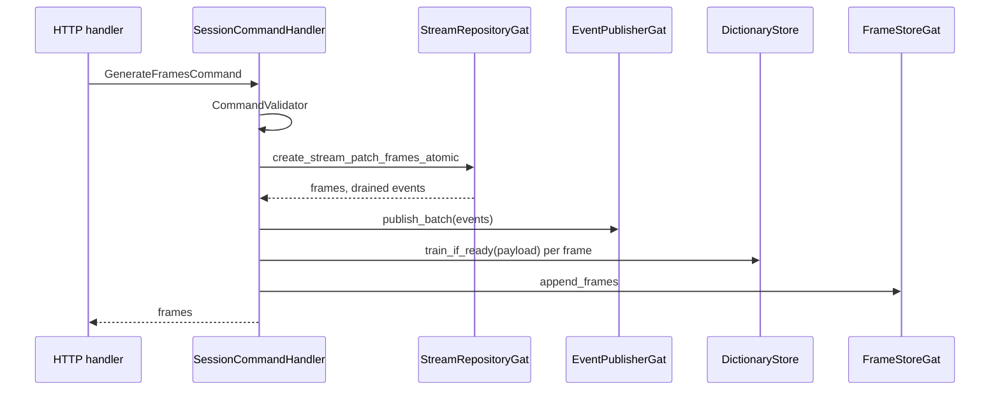

---
aliases:
  - Application Commands Plan
tags:
  - sdd
  - plan
  - application
  - cqrs
created: 2026-11-15
status: implemented
related:
  - "[[055-application-commands/spec|spec]]"
code:
  - crates/pjs-core/src/application/handlers/command_handlers.rs
verified: 2026-11-15
---

# Plan 055: Application Commands (as built)

## Architecture

## Design decisions
- Atomic repository calls replaced find-mutate-save to remove lost updates (#457, PR #472, #499).
- Events are published before frame persistence to avoid losing already-drained events on a later failure.
- The dictionary store is a `dyn DictionaryStore` (boxed futures); the frame store is a generic type parameter with `InMemoryFrameStore` default.
- Validation returns `Vec<String>` and is joined once into `ApplicationError::Validation`.

## Public API surface
`pjson_rs::commands` (module), `pjson_rs::application::{commands::*, ApplicationError, ApplicationResult, AdjustmentUrgency}`, `application::handlers::{CommandHandlerGat, QueryHandlerGat, command_handlers::{SessionCommandHandler, CommandValidator}}`.

## Contracts

| Function | Preconditions | Postconditions | Undefined or caller-risk |
|---|---|---|---|
| `handle(CreateSessionCommand)` | limits valid | active session saved, events published once | save OK but publish error leaves the session stored |
| `handle(CreateStreamCommand)` | non-null data, active session below limit | `StreamId`, events published | errors from domain pass through as `Domain` |
| `handle(GenerateFramesCommand)` | `1..=1000` frames, stream `Streaming` | frames returned and stored; session stats updated | frame store failure after publish |
| `handle(BatchGenerateFramesCommand)` | active session | frames sorted by priority desc, stored grouped by stream | no upper bound on `max_frames` |
| `handle(CloseSessionCommand)` | session `Active` | session `Completed`, streams cancelled | `Domain(InvalidStateTransition)` otherwise |
| `CommandValidator::validate_*` | none | `Ok` or all violations | pure |

## Testing strategy
- 32 async unit tests in `command_handlers.rs` with `MockRepository` from `crate::test_support` and `RecordingEventPublisher`.
- Concurrency regression tests for lost updates and event leakage.
- HTTP-level coverage in `tests/http_axum_endpoints.rs`.
- No fuzz target; no benchmark for handlers (`gat_query_benchmarks` covers the query side).

## Security notes
Input caps (FR-009), bounded frame batch (`MAX_FRAMES_PER_REQUEST`), timeouts bounded to avoid chrono panic, dictionary training skips errors rather than failing the request.
