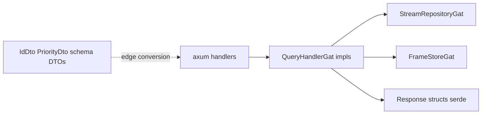

---
aliases:
  - Application Queries Plan
tags:
  - sdd
  - plan
  - application
  - cqrs
created: 2026-11-15
status: implemented
related:
  - "[[056-application-queries-dto/spec|spec]]"
code:
  - crates/pjs-core/src/application/handlers/query_handlers.rs
verified: 2026-11-15
---

# Plan 056: Application Queries and DTOs (as built)

## Architecture

## Design decisions
- Stream queries read through the session aggregate (`find_session` then `stream(id)`), not through `StreamStoreGat`, so there is one source of truth.
- Page caps live in the handlers (100 sessions, 1000 frames); `Pagination::new` rejects out-of-range values at construction.
- `SearchSessions` clamps instead of failing; `GetActiveSessions` fails on invalid paging (inconsistent, see spec Open Questions).
- DTOs wrap domain value objects with `#[serde(transparent)]` so JSON stays a bare UUID or integer.
- Schema DTO deserialization uses a thread-local depth counter and RAII guard (`enter_deserialize_depth`) shared with `pjs-domain`.

## Public API surface
`pjson_rs::queries` (module), `pjson_rs::application::{queries::*, dto::*, handlers::{QueryHandlerGat, query_handlers::{SessionQueryHandler, StreamQueryHandler, SystemQueryHandler}}}`; crate root re-exports `SchemaDefinitionDto`, `SchemaMetadataDto`, `SchemaRegistrationDto`, `ValidationErrorDto`, `ValidationRequestDto`, `ValidationResultDto`.

## Contracts

| Function | Preconditions | Postconditions | Undefined or caller-risk |
|---|---|---|---|
| `handle(GetSessionQuery)` | none | session or `NotFound` | clones whole session |
| `handle(GetActiveSessionsQuery)` | limit >= 1 when `Some` | page of sessions in any state | order unspecified without sort |
| `handle(SearchSessionsQuery)` | none | page, default scope active and not expired | `total_count` capped by adapter result limit |
| `handle(GetStreamFramesQuery)` | session and stream exist | at most 1000 frames ascending by sequence | `priority_filter` must be non-zero |
| `handle(GetSystemStatsQuery)` | none | sums over at most 10 000 active sessions | `include_historical` ignored |
| `PriorityDto::new` | none | `Ok` iff value is non-zero | deserialization bypasses |

## Testing strategy
- 43 unit tests in `query_handlers.rs` (mocks `MockStreamStore`, `FixedTimeProvider`, `crate::test_support::MockRepository`).
- 60 tests in `schema_dto.rs`; unit tests in `id_dto.rs` and `priority_dto.rs`.
- Integration: `tests/http_dto_serialization.rs`, `tests/http_axum_endpoints.rs`.
- Bench: `crates/pjs-bench/benches/gat_query_benchmarks.rs`.

## Security notes
Bounded pages and offsets; bounded schema nesting; `client_info` filter uses `to_lowercase().contains` (allocation per candidate session, bounded by scan cap).
