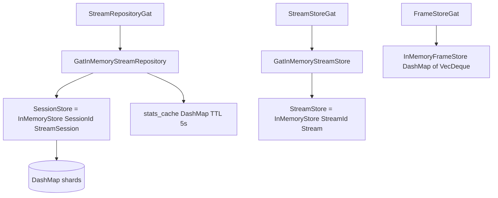

---
aliases:
  - In-Memory Repositories Plan
tags:
  - sdd
  - plan
  - infrastructure
created: 2026-11-15
status: implemented
related:
  - "[[057-in-memory-repositories/spec|spec]]"
code:
  - crates/pjs-core/src/infrastructure/adapters/gat_memory_repository.rs
  - crates/pjs-core/src/infrastructure/adapters/generic_store.rs
verified: 2026-11-15
---

# Plan 057: In-Memory Repositories (as built)

## Architecture

## Design decisions
- `DashMap` for sharded locking; `get` returns clones so no guard escapes an `.await`.
- Atomicity is a closure run under the shard write lock (`update_with`); expensive extraction runs outside it on a snapshot and is validated again at commit.
- Scans are bounded by `filter_limited` rather than by pagination alone, so a hostile client cannot force an unbounded clone.
- Health `total_frames` is cached for 5 s to avoid summing every stream on each poll.
- Frame history is a per-stream ring (`VecDeque`) with FIFO eviction.

## Public API surface
`pjson_rs::infrastructure::{GatInMemoryStreamRepository, GatInMemoryStreamStore, InMemoryFrameStore, InMemoryStore, SessionStore, StreamStore, MAX_SCAN_LIMIT, MAX_RESULTS_LIMIT, MAX_HEALTH_METRICS, MAX_PAGINATION_LIMIT, MAX_PAGINATION_OFFSET}` (also under `infrastructure::adapters`).

## Contracts

| Function | Preconditions | Postconditions | Undefined or caller-risk |
|---|---|---|---|
| `InMemoryStore::update_with` | closure must not call back into the same store key | closure ran under write lock iff key present | deadlock if closure re-enters the shard |
| `filter_limited` | none | at most `result_limit` items, at most `scan_limit` scanned; flag set if a bound stopped it | arbitrary order, weakly consistent |
| `*_atomic` | none | session mutated and events drained atomically | `SessionNotFound` if absent |
| `find_sessions_by_criteria` | valid criteria and pagination | page plus capped `total_count` | unstable order without `sort_by` |
| `InMemoryFrameStore::append_frames` | none | at most cap frames kept, oldest dropped | cap 0 clamped to 1 |
| `InMemoryFrameStore::get_frames` | none | ascending by append order | linear scan under shard read lock |

## Testing strategy
- Unit tests in each adapter file (concurrency, eviction, caps; `ManualTimeProvider` is used for session expiry cases).
- Integration: `tests/gat_repository_comprehensive.rs`, `tests/repositories_comprehensive.rs`, `tests/security_bounded_iteration_integration.rs`, `tests/http_axum_endpoints.rs`.
- Bench: `crates/pjs-bench/benches/gat_query_benchmarks.rs`.
- No fuzz target.

## Security notes
Scan cap 10 000 (about 10 ms at 1 us per item), result cap 10 000, pagination cap 1000 and offset cap 1 000 000, per-stream frame cap 10 000. Session count is not capped (spec 057 Open Questions).
