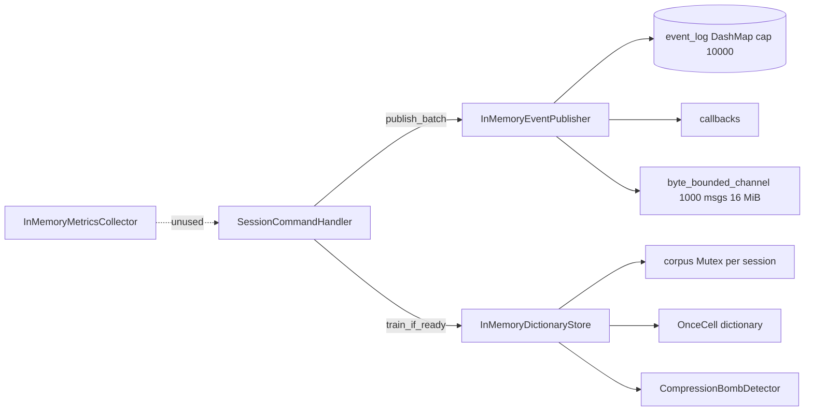

---
aliases:
  - Event, Metrics and Dictionary Adapters Plan
tags:
  - sdd
  - plan
  - infrastructure
created: 2026-11-15
status: partial
related:
  - "[[058-event-metrics-dictionary-adapters/spec|spec]]"
code:
  - crates/pjs-core/src/infrastructure/adapters/event_publisher.rs
  - crates/pjs-core/src/infrastructure/repositories/dictionary_store.rs
verified: 2026-11-15
---

# Plan 058: Event, Metrics and Dictionary Adapters (as built)

## Architecture

## Design decisions
- Event identity is a surrogate `EventId` minted at store time because `DomainEvent` has none; ordering uses a per-instance `sequence` because `EventId` is a random UUID and DashMap has no order.
- Channel delivery is best-effort (`try_send`, drop on full) so a slow consumer never back-pressures request handling.
- Dictionary training is race-free by construction: `OnceCell::get_or_try_init` plus a drop-guard reservation of corpus bytes, so cancellation cannot leak budget.
- Background eviction holds `Weak` references so it never keeps the store alive.
- Metrics collector uses `parking_lot::RwLock` over plain maps (simple, not lock-free).

## Public API surface
`infrastructure::{InMemoryEventPublisher, StoredEvent, InMemoryMetricsCollector, PerformanceMetrics, SessionMetrics, StreamMetrics, TimestampedMetrics}`; `infrastructure::repositories::InMemoryDictionaryStore` (feature `compression`); `infrastructure::bounded_channel::{byte_bounded_channel, ByteBoundedSender, Envelope, SendError, TrySendError}`.

## Contracts

| Function | Preconditions | Postconditions | Undefined or caller-risk |
|---|---|---|---|
| `InMemoryEventPublisher::publish` | none | event stored, callbacks invoked once each | callback panics propagate |
| `publish_batch` | none | all events stored with consecutive sequences | callback order unspecified |
| `with_channel` | none | receiver sees events in publish order unless dropped | dropped events not retried |
| `recent_events(n)` | none | up to `n` newest by sequence | sequence is per instance |
| `InMemoryDictionaryStore::train_if_ready` | feature on | at most one training per session | skips oversized/over-budget samples silently |
| `get_dictionary` | none | `Some` only after training or `register` | `None` for unknown session |
| `cleanup_expired(ttl)` | none | idle sessions removed, byte counter resynced | concurrent training sessions keep their reservation |
| `InMemoryMetricsCollector::increment_counter` | none | known name updated | unknown name ignored silently |

## Testing strategy
- Unit tests in each file; eviction race hook (`EVICTION_RACE_HOOK`, `cfg(test)`) for deterministic interleaving.
- Integration: `tests/event_publisher_comprehensive.rs`; dictionary endpoint tests in `infrastructure/http/handlers/dictionary.rs`.
- Fuzz: `fuzz/fuzz_targets` has no target for these adapters (open issue #575 tracks ZstdDict fuzzing).

## Security notes
Memory bounds in spec NFR-MEM-001; training and registration pass through `CompressionBombDetector`; samples are capped at 1 MiB.
