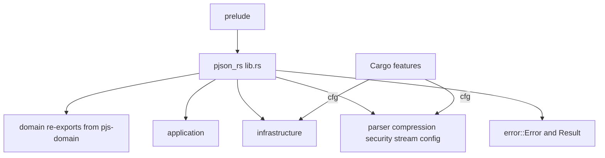

---
aliases:
  - Crate API, Errors and Features Plan
tags:
  - sdd
  - plan
  - api
  - features
created: 2026-11-15
status: partial
related:
  - "[[059-crate-api-errors-features/spec|spec]]"
code:
  - crates/pjs-core/src/lib.rs
  - crates/pjs-core/src/error.rs
  - crates/pjs-core/Cargo.toml
  - crates/pjs-core/build.rs
verified: 2026-11-15
---

# Plan 059: Crate API, Errors and Features (as built)

## Architecture

## Design decisions
- Root re-exports flatten the most used types across layers; the full paths remain public (`pjson_rs::domain::...`, `pjson_rs::application::...`).
- Two crates: `pjson-rs-domain` (WASM-safe, no tokio) and `pjson-rs` (this crate); `pjs-wasm` depends only on the former, so the `http-server` stack never reaches wasm builds.
- Features are additive marker or dependency toggles; the optional-dependency set is exactly what each module needs (`http-server` carries the whole axum stack).
- `Error` is one flat enum with `String` payloads and a `category()` helper for metrics labels; domain and application errors stay separate types.
- `mimalloc` is the only allocator feature; registration lives in `global_alloc.rs` only.

## Public API surface
See spec FR-002 to FR-004. Feature-gated root items: `SecureWebSocketHandler` (`websocket-client` or `websocket-server`, effectively needs `http-server`). Gated module paths: `infrastructure::http`, `infrastructure::websocket` (`http-server`), `infrastructure::repositories::InMemoryDictionaryStore` (`compression`, non-wasm).

## Contracts

| Function | Preconditions | Postconditions | Undefined or caller-risk |
|---|---|---|---|
| `Error::category()` | none | one of nine static labels | stable strings, not `non_exhaustive` |
| `Error::from(io::Error)` | none | `Error::Io(msg)` | source lost |
| `Error::is_validation_error()` | none | true for `SchemaValidation`, `SemanticTypeMismatch`, `InvalidFrame` | `SessionLimitReached` is a client error |
| `global_allocator_name()` | none | `"mimalloc"` or `"system"` | reflects compile-time feature only |

## Testing strategy
- Unit tests in `error.rs` (constructors, classification, categories, display, conversions, clone).
- Doc-test for `global_allocator_name`.
- CI (`.github/workflows/ci.yml`): `quality` (fmt, clippy `--all-features`), `build`/`test` (3 OS x 2 allocators), `doctest`, `docs`, `coverage`, fuzz jobs, `security-deny`, `security-osv`.
- Gap: no per-feature matrix (#615), which hid #598.

## Security notes
Feature `mimalloc` can conflict with a downstream allocator; `http-auth-jwt` is opt-in; `simd-avx512` requires explicit target features. `cargo deny` and OSV scans run in CI.
