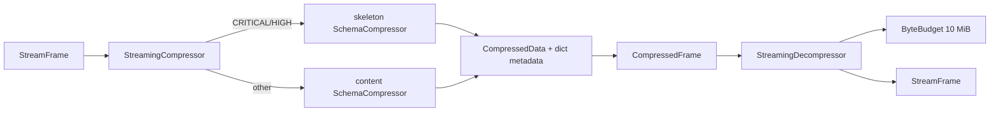

---
aliases:
  - Streaming Frame Compression Plan
tags:
  - sdd
  - plan
created: 2026-11-15
status: implemented
related:
  - "[[047-streaming-frame-compression/spec]]"
verified: 2026-11-15
---

# Plan 047: Streaming Frame Compression (as built)

[[047-streaming-frame-compression/spec|Spec]] | [[MOC-specs]]

## Architecture

Unconditionally compiled (no feature gate); depends only on `compression::{SchemaCompressor, ...}` and `serde_json`.

## Design decisions

- Self-describing dictionary markers (`\u{7F}<index>`) so decoding needs no positional metadata (#333).
- Decoder-side budget measured in estimated heap bytes rather than element counts, charged before allocation.
- Per-frame dictionary; no cross-frame decoder state (`StreamingDecompressor` keeps statistics only).

## Public API surface

`StreamingCompressor::{new, with_strategies, compress_frame, optimize_for_data, stats, reset_stats}`, `StreamingDecompressor::{new, decompress_frame, decompress_delta, decompress_run_length, stats}`, `CompressedFrame`, `DecompressionMetadata`, `CompressionStats`, `DecompressionStats`; all re-exported from the crate root.

## Contracts

| Function | Precondition | Postcondition | Notes |
|---|---|---|---|
| `compress_frame` | none | `decompress_frame(result)` returns an equal `data` | frame priority chooses compressor only |
| `decompress_frame` | metadata matches the data's strategy | `Ok(StreamFrame)` with same priority/metadata, or `CompressionError` | never panics on malformed input (fuzzed) |
| `decompress_delta` (pub) | none | restores integer/float arrays | not budget-charged |
| `decompress_run_length` (pub) | none | expansion <= 10 MiB estimated | `MAX_RLE_COUNT` per run |

## Testing strategy

- Unit: `stream/compression_integration.rs` (93 tests).
- Integration: `crates/pjs-core/tests/compression_integration_coverage.rs`, `compression_integration_phase2.rs`, `compression_streaming_integration.rs`.
- Fuzz: `fuzz/fuzz_targets/streaming_decompressor.rs`.
- Bench: none dedicated.

## Security notes

Attack surface is decompression amplification (RLE counts, dictionary fan-out, delta arrays); all three are bounded as in FR-007..FR-009. The decoder trusts metadata `strategy` supplied alongside the data.
