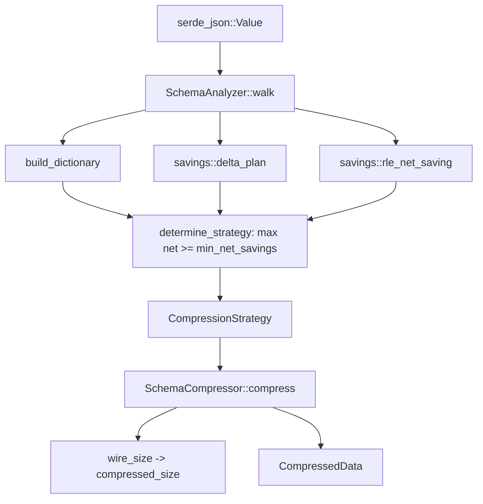

---
aliases:
  - Schema Compression Strategies Plan
tags:
  - sdd
  - plan
created: 2026-11-15
status: implemented
related:
  - "[[048-schema-compression-strategies/spec]]"
verified: 2026-11-15
---

# Plan 048: Schema Compression Strategies (as built)

[[048-schema-compression-strategies/spec|Spec]] | [[MOC-specs]]

## Architecture

`savings.rs` holds byte-exact models (`ByteCount` writer, `json_len`) shared by analyzer and encoder, so modelled saving equals measured difference for compact `serde_json` output.

## Design decisions

- Select by exact saving, not heuristic scores (fix for #333: absolute thresholds never triggered).
- Sentinel-marker strings instead of positional index lists.
- Delta against the array minimum so offsets are non-negative `u64`.
- Caps shared by encoder and decoder through `pub(crate)` constants.

## Public API surface

`CompressionConfig::{default, validate}`, `CompressionStrategy`, `SchemaAnalyzer::{new, with_config, analyze}`, `SchemaCompressor::{new, with_strategy, with_config, analyze_and_optimize, compress}`, `CompressedData::{compression_ratio, compression_savings}`. Crate root re-exports `CompressedData`, `CompressionConfig`, `CompressionStrategy`, `SchemaAnalyzer`, `SchemaCompressor`.

## Contracts

| Function | Precondition | Postcondition | Notes |
|---|---|---|---|
| `SchemaAnalyzer::analyze` | validated config | strategy with modelled net >= `min_net_savings`, else `None` | deterministic |
| `SchemaCompressor::compress` | strategy consistent with data | `compressed_size` = measured wire bytes; decoder in spec 047 inverts exactly | `Dictionary` map must be a valid index map |
| `build_dictionary` (private) | | indices contiguous from 0, at most 65535 entries (indices 0..=65534) | |
| `delta_plan` (private) | | `Some` only if saving > 0 and all offsets fit `u64` | |

## Testing strategy

36 unit tests in `compression/mod.rs`, 5 in `compression/savings.rs`; integration suites `crates/pjs-core/tests/compression_*.rs`. No fuzz target for the encoder, no benchmark.

## Security notes

Encoder output is bounded by the same constants the decoder enforces; the analyzer is O(n) in payload nodes with a per-array re-serialisation cost for delta planning.
