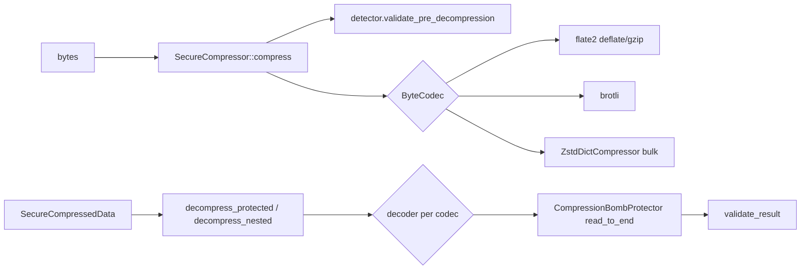

---
aliases:
  - Secure Byte Compression Plan
tags:
  - sdd
  - plan
created: 2026-11-15
status: implemented
related:
  - "[[049-secure-byte-compression/spec]]"
verified: 2026-11-15
---

# Plan 049: Secure Byte Compression (as built)

[[049-secure-byte-compression/spec|Spec]] | [[MOC-specs]]

## Architecture

A private `run!` macro executes the same read loop for every decoder type so no codec can bypass the protector.

## Design decisions

- Single `Arc<ZstdDictionary>` at the enum level (one refcount bump per clone).
- Codec tag travels with the data in-process; no wire format promised.
- Layer separation: Layer A (`SchemaCompressor`, [[048-schema-compression-strategies/spec|spec 048]]) is JSON-aware, Layer B works on bytes.

## Public API surface

`SecureCompressor::{new, with_default_security, with_quality, compress, decompress_protected, decompress_nested}`, `ByteCodec`, `CompressionQuality`, `SecureCompressedData`, `SecureDecompressionContext::{new, start_stream, finish_stream, stats}`, `DecompressionContextStats`; `zstd::{ZstdDictionary, ZstdDictCompressor, MAX_DICT_SIZE, N_TRAIN, DEFAULT_LEVEL}`. Crate root re-exports the `secure` types.

## Contracts

| Function | Precondition | Postcondition | Notes |
|---|---|---|---|
| `compress` | `data.len() <= max_compressed_size` | decodable by `decompress_protected` with the same codec | `ZstdDict` requires the same dictionary |
| `decompress_protected` | `compressed.data.len() <= max_compressed_size` | output <= `max_decompressed_size` and ratio <= `max_ratio`, else `Error::CompressionBomb`; corrupt input is `Error::Codec{..Decompress}` | streaming, bounded memory aside from output `Vec` |
| `decompress_nested(.., depth)` | `depth <= max_compression_depth` | as above | depth is caller-asserted |
| `ZstdDictionary::from_bytes` | none | `1 <= len <= 112 KiB`, magic present | only constructor besides `train` |
| `ZstdDictCompressor::decompress` | none | output <= `max_output` | not bomb-protected |

## Testing strategy

Unit: `compression/secure.rs` (37), `compression/zstd.rs` (9, plus doc-tests). Fuzz: `fuzz/fuzz_targets/secure_decompress.rs`. Dictionary store tests in `infrastructure/repositories/dictionary_store.rs`. No benchmarks.

## Security notes

Defence relies on spec 050 limits. Zstd dictionaries are size- and magic-checked; decoder initialisation errors are mapped to `Error::Codec` (`Train`/`Decompress`); dictionary problems to `Error::InvalidDictionary`.
