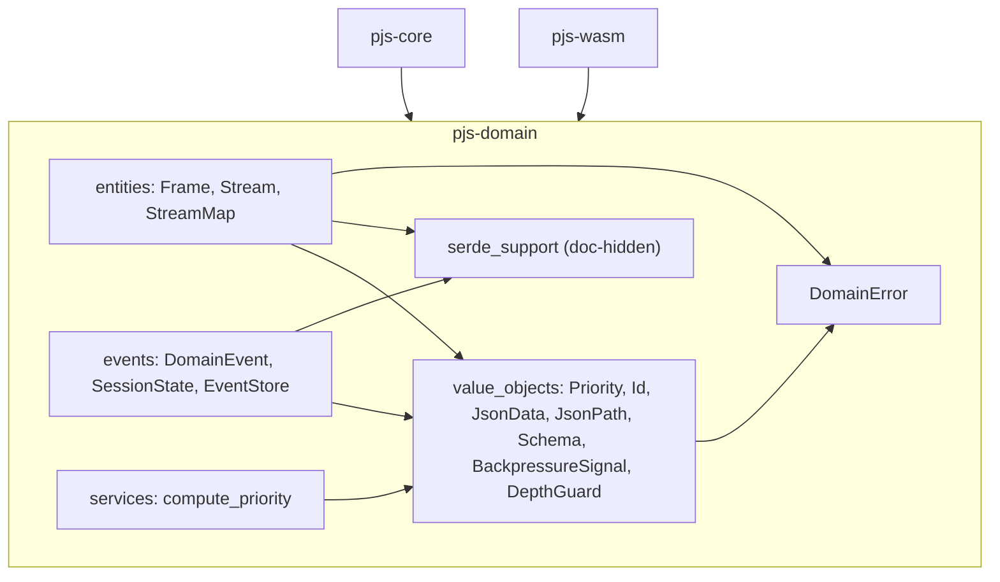

---
aliases:
  - Domain Crate and Value Objects Plan (as built)
tags:
  - sdd
  - plan
  - domain
created: 2026-11-15
status: implemented
related:
  - "[[042-domain-crate-contract-and-value-objects/spec]]"
verified: 2026-11-15
---

# Plan 042: Domain Crate Contract and Value Objects (as built)

Spec: [[042-domain-crate-contract-and-value-objects/spec|042]]. Index: [[MOC-specs]].

## Architecture

`pjs-domain` is the innermost crate: `pjs-core` re-exports it (`pjson_rs::domain::*`) and `pjs-wasm` depends on it directly (no features). It has no dependency on either.

Module layout: `lib.rs` (errors, re-exports), `value_objects/{priority,id,json_data,json_path,schema,backpressure,depth_guard}.rs`, `entities/{frame,stream,stream_map}.rs`, `events/mod.rs`, `services/priority.rs`, `serde_support.rs`.

## Design decisions

- Newtype/phantom-type value objects: `Priority(NonZeroU8)`, `Id<T: IdMarker>` with a sealed marker trait, validated `JsonPath` segments.
- Value objects with invariants do not derive serde; embedding types choose their wire encoding via `#[serde(with = "serde_support::...")]` so one encoding exists per type.
- `JsonData` is the domain's own JSON type (not `serde_json::Value`) so the domain API does not leak a serialisation library; conversion from `serde_json::Value` exists for adapters.
- `JsonPath` consolidates two earlier copies into one segmented type (CHANGELOG 0.6.3 Changed, #379).
- Enums that may grow are `#[non_exhaustive]` (`DomainError`, `JsonData`, `PathSegment`, `BackpressureSignal`, state/frame enums).
- `unsafe_code = "forbid"` at manifest level.

## Public API surface

Root re-exports: `Frame`, `Stream`, `DomainEvent`, `SessionState`, `PriorityHeuristicConfig`, `compute_priority`, `JsonData`, `JsonPath`, `PathSegment`, `Priority`, `Schema`, `SessionId`, `StreamId`, `MAX_DESERIALIZE_DEPTH`, `DomainError`, `DomainResult`. Module `value_objects` additionally exports `Id`, `IdMarker`, `SessionMarker`, `StreamMarker`, `BackpressureSignal`, `DepthGuard`, `enter_deserialize_depth`, `SchemaId`, `SchemaType`, `SchemaValidationError`, `SchemaValidationResult`.

## Contracts

| Function | Preconditions | Postconditions | Undefined / notes |
|---|---|---|---|
| `Priority::new(v)` | none | `Ok` iff `v != 0` | |
| `Priority::increase_by/decrease_by` | none | result in `1..=255`, saturating | |
| `Priority::from_percentage(p)` | `0.0 <= p <= 100.0` | value in `1..=255` | NaN rejected |
| `Id::<T>::new()` | none | random v4 UUID | uses OS randomness (`js` feature on wasm32) |
| `Id::<T>::from_string(s)` | none | `Ok` iff `s` parses as a UUID | accepts any UUID version/format `uuid` accepts |
| `JsonPath::new(s)` | none | `Ok(p)` implies `p.to_string()` reparses to `p` | keys with `.`, `[`, `]` impossible |
| `JsonPath::append_key(k)` | `k` non-empty, no `.[]` | new path, depth + 1 | original unchanged (clones segments, O(depth)) |
| `JsonPath::is_prefix_of(o)` | none | strict prefix only; a path is not its own prefix | |
| `JsonData::float(f)` | none | `Ok` iff finite | direct `JsonData::Float(NAN)` bypasses it |
| `JsonData::set_path(p, v)` | none | `true` iff stored | `false` if traversal hits a non-object |
| `JsonData::deserialize` | any serde `Deserializer` | `Err` beyond depth 64 or on non-finite float | |
| `BackpressureSignal::suggested_delay_ms` | none | 0 / 100 / `u64::MAX` | `u64::MAX` means "until resumed" |

## Testing strategy

- Unit tests next to each module; integration tests `tests/{json_data,schema,frame,stream,events}_comprehensive.rs`; `tests/property_tests.rs` (proptest for priority arithmetic/ordering, id round trips and hashing, path building); `tests/id_zero_cost_test.rs` (size/alignment equal to `Uuid`); `tests/serde_golden.rs` (wire literals).
- Doc tests including a `compile_fail` for mixing `SessionId`/`StreamId`.
- Domain crate is tested in the main nextest matrix; `pjs-wasm` tests are wasm32-only (see `.github/workflows/ci.yml` comments).

## Security notes

- `JsonData` and `Schema` deserialisation are depth-bounded; `StreamMap` decoding does not trust `size_hint`.
- No `unsafe`, no I/O, no global state except per-type thread-local depth counters ([[043-domain-schema-depth-guard-wire-encoding/spec|043]]).
