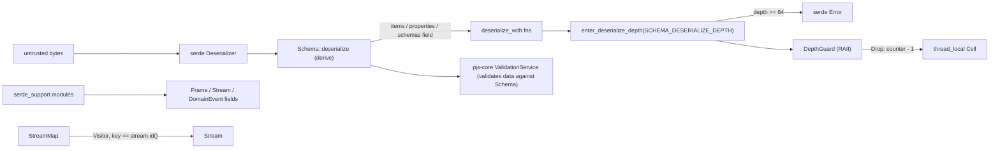

---
aliases:
  - Schema, Depth Guard and Wire Encoding Plan (as built)
tags:
  - sdd
  - plan
  - domain
  - schema
created: 2026-11-15
status: implemented
related:
  - "[[043-domain-schema-depth-guard-wire-encoding/spec]]"
verified: 2026-11-15
---

# Plan 043: Schema, Depth Guard and Wire Encoding (as built)

Spec: [[043-domain-schema-depth-guard-wire-encoding/spec|043]]. Index: [[MOC-specs]].

## Architecture

`JsonData` uses a different mechanism (hand-written `Visitor` threading depth through a `DeserializeSeed`) because it is not derive-based; `Schema` is derive-based, hence the thread-local approach.

## Design decisions

- One shared guard primitive instead of per-type copies (extracted after #470 and #476).
- A per-type thread-local counter keeps `Schema`'s depth independent of other recursive types.
- Domain `Schema` is data only; regex compilation, caching and limits live in `pjs-core` so the domain crate stays WASM-friendly and `regex`-free.
- `serde_support` centralises encodings to remove the earlier situation where `Priority`/id types had divergent per-site encodings.
- `StreamMap` enforces "key equals id" at decode and insert time, so a map cannot disagree with its contents.

## Public API surface

`pjson_rs_domain::value_objects::{Schema, SchemaId, SchemaType, SchemaValidationError, SchemaValidationResult, DepthGuard, enter_deserialize_depth}`, `pjson_rs_domain::{Schema, MAX_DESERIALIZE_DEPTH}`, `pjson_rs_domain::entities::StreamMap`, `#[doc(hidden)] pjson_rs_domain::serde_support`.

## Contracts

| Function | Preconditions | Postconditions | Undefined / notes |
|---|---|---|---|
| `enter_deserialize_depth(counter, name)` | `counter` is a `'static` thread-local for this type | `Ok(guard)`: counter + 1 until guard drops; `Err`: counter unchanged | the guard must be held for the nested call or the check is void (`#[must_use]`) |
| `DepthGuard::drop` | counter > 0 | counter - 1 | `depth.get() - 1` would underflow only if a guard were dropped without a matching increment (not constructible externally) |
| `Schema::allows_type(t)` | none | see FR-043-002 | `Any` allows everything |
| `Schema::validation_cost()` | none | positive heuristic | recursion over the schema; depth bounded only for deserialised schemas |
| `StreamMap::insert(stream)` | none | key is `stream.id()`; returns replaced stream | |
| `StreamMap::get_mut(id)` | none | `&mut Stream` | assigning a different stream through it can break the key invariant (documented) |
| `serde_support::priority::deserialize` | none | validated `Priority` | zero rejected |

## Testing strategy

- `tests/schema_comprehensive.rs` (constructors, `allows_type`, cost, error display, serde), unit tests in `schema.rs` (`test_schema_deserialize_at_max_depth_succeeds`, `..._beyond_max_depth_rejected`, small-nesting round trip), `depth_guard.rs` unit tests (limit, RAII decrement), `serde_support.rs` tests, `tests/serde_golden.rs`.
- `StreamMap` unit tests for mismatched key, duplicate id and round trip.
- `pjs-core` `application/dto/schema_dto.rs` has parallel depth tests for `SchemaDefinitionDto`.

## Security notes

- Closes CWE-674 for schema documents delivered in non-`serde_json` formats; regression tests assert the counter resets to 0 after errors.
- The regex DoS controls (pattern length, compile size, DFA size, cache size) are in `pjs-core` `ValidationService`, see [[041-simd-features-and-global-allocator/spec|041]] FR-041-009.
