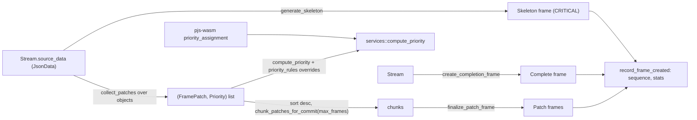

---
aliases:
  - Domain Entities, Events and Priority Plan (as built)
tags:
  - sdd
  - plan
  - domain
  - entities
created: 2026-11-15
status: implemented
related:
  - "[[044-domain-entities-events-priority-heuristic/spec]]"
verified: 2026-11-15
---

# Plan 044: Domain Entities, Events and Priority Heuristic (as built)

Spec: [[044-domain-entities-events-priority-heuristic/spec|044]]. Index: [[MOC-specs]].

## Architecture

```mermaid
stateDiagram-v2
  [*] --> Preparing: Stream::new
  Preparing --> Streaming: start_streaming
  Preparing --> Failed: fail
  Preparing --> Cancelled: cancel
  Streaming --> Completed: complete
  Streaming --> Failed: fail
  Streaming --> Cancelled: cancel
  Completed --> [*]
  Failed --> [*]
  Cancelled --> [*]
```



Split of work inside `Stream`: `create_patch_frames` = `extract_prioritized_patches(&self)` (pure) + `commit_patch_frames(&mut self)`; the split lets `pjs-core` plan with `&` access and commit under `&mut`.

## Design decisions

- Entities hide fields and expose behaviour (`Frame` has no setters; `Stream` mutates via state-checked methods).
- `compute_priority` lives in a domain service module so server and WASM share one rule set; per-stream rules map to its `overrides`.
- Sequence numbers are assigned by the stream (`next_sequence`), not by callers, so frames from one stream are strictly increasing from 1.
- Chunking assigns a chunk the highest priority among its patches, trading precision for fewer frames.
- Events are a single tagged enum so the wire form is one JSON object with `event_type`; `event_type()` mirrors the tag for use without serialising.

## Public API surface

`pjson_rs_domain::{Frame, Stream, DomainEvent, SessionState, PriorityHeuristicConfig, compute_priority}`; modules `entities::{frame::{Frame, FrameType, FramePatch, PatchOperation}, stream::{Stream, StreamConfig, StreamState, StreamStats}, StreamMap}`, `events::*`, `services::*`. In `pjs-core`, `pjson_rs::DomainFrame` is the re-export of `Frame`.

## Contracts

| Function | Preconditions | Postconditions | Undefined / notes |
|---|---|---|---|
| `Stream::new(session, data, cfg)` | none | state `Preparing`, `next_sequence == 1`, fresh id | `source_data = Some(data)` |
| `Stream::start_streaming` | state `Preparing` | state `Streaming`, `updated_at` bumped | else `InvalidStateTransition`, state unchanged |
| `Stream::create_skeleton_frame` | `Streaming`, `source_data` is `Some` | frame seq == previous `next_sequence`; stats updated | else `InvalidStreamState` |
| `Stream::create_patch_frames(th, n)` | `Streaming` | at most `n` frames, descending priority order of content, sequences consecutive | `n == 0` yields no frames |
| `Stream::chunk_patches_for_commit(p, n)` | none | `ceil(len/n)`-sized chunks; empty if `p` empty or `n == 0` | static function |
| `Stream::complete` | `Streaming` | `Completed`, `completed_at` set | |
| `Stream::update_config` | active | config replaced | `InvalidStreamState` if finished |
| `Frame::patch` | non-empty patches | `Patch` frame whose payload passes `validate()` | |
| `Frame::validate` | none | `Ok` iff type-specific rules hold | not invoked on decode |
| `DomainEvent::event_type` | none | equals the serde `event_type` tag | |
| `compute_priority(cfg, path, value)` | none | result in `1..=255`; override > field list > shape fallback | pure, total, no panics |
| `StreamMap::insert` | none | key == `stream.id()` | |

## Testing strategy

- `tests/frame_comprehensive.rs`, `tests/stream_comprehensive.rs`, `tests/events_comprehensive.rs`, unit tests in each module and in `services/priority.rs`.
- `tests/serde_golden.rs` pins `Frame`, `Stream`, `DomainEvent` wire forms.
- `pjs-wasm` tests (wasm32 only) exercise `compute_priority` through the JS-facing config builder.
- No fuzz target or benchmark targets the domain crate directly.

## Security notes

- No I/O, `unsafe` forbidden, errors are values.
- Frame/stream sizes are not bounded inside the domain crate; limits belong to `pjs-core` configs ([[051-security-limits-and-validated-config/spec|051]]).
- Recursive walkers (`generate_skeleton`, `collect_patches`) rely on callers (or deserialisation) bounding `JsonData` depth.
