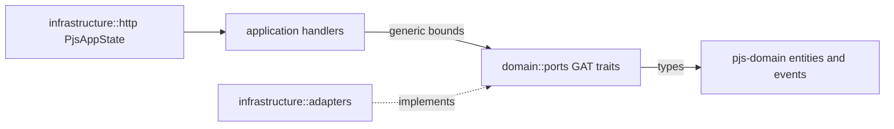

---
aliases:
  - Domain GAT Ports Plan
tags:
  - sdd
  - plan
  - domain
  - ports
created: 2026-11-15
status: implemented
related:
  - "[[052-domain-gat-ports/spec|spec]]"
  - "[[constitution]]"
code:
  - crates/pjs-core/src/domain/macros.rs
  - crates/pjs-core/src/domain/ports/gat.rs
verified: 2026-11-15
---

# Plan 052: Domain GAT Ports (as built)

## Architecture
Ports live in `pjs-core::domain::ports`. Entities, value objects, events and `DomainError` come from `pjs-domain` (re-exported by `domain/mod.rs`); `StreamSession` and the ports live in `pjs-core` because they need `tokio`/`jiff` types and async.

## Design decisions
- `gat_port!` generates `type XFuture<'a>: Future<Output = DomainResult<T>> + Send + 'a where Self: 'a` per method. Adapters implement with `impl Future` in associated types (`#![feature(impl_trait_in_assoc_type)]`, crate-level, nightly). Upstream stabilisation is tracked in issue #580.
- Hand-written GAT traits (`MetricsCollectorGat`, `CacheGat`, `SessionTransactionGat`, `WriterFactoryGat`, `ConnectionMonitorGat`) exist where borrowed `&str` arguments or `Box<Self>` receivers do not fit the macro grammar.
- Atomic repository methods push the read-modify-write into the port so adapters can hold a per-key lock; the generic handler no longer does find-mutate-save (PR #472, #499).
- Supporting types sit in `repositories.rs` and `writer.rs`; the trait definitions are all in `gat.rs` (re-exported through `ports/mod.rs`).
- `DictionaryStore` is intentionally outside `gat` and uses boxed futures to avoid `async-trait`.

## Public API surface
`pjson_rs::domain::ports::*`: traits listed in spec FR-002..FR-008, `FrameStorePage`, `Pagination`, `SessionPagination`, `FramePagination`, `SessionSortField`, `FrameSortField`, `SortOrder`, `SessionQueryCriteria`, `SessionQueryResult`, `SessionHealthSnapshot`, `StreamFilter`, `StreamStatus`, `StreamMetadata`, `StreamStatistics`, `FrameQueryResult`, `CacheStatistics`, `WriterConfig`, `WriterMetrics`, `BackpressureStrategy`, `ConnectionState`, `ConnectionMetrics`, `DictionaryStore`, `DictionaryFuture`, `NoopDictionaryStore`, `TimeProvider`, `SystemTimeProvider`. At crate root only `EventPublisherGat`, `FrameSinkGat`, `FrameSinkGatExt`, `FrameSourceGat`, `StreamRepositoryGat`, `StreamStoreGat` are re-exported.

## Contracts

| Function | Preconditions | Postconditions | Undefined or caller-risk |
|---|---|---|---|
| `StreamRepositoryGat::save_session` | none | stored session equals argument | races with concurrent `*_atomic` on same id can drop an update |
| `create_stream_atomic` | session exists and is active; below `max_concurrent_streams` | new `StreamId`; all pending events drained | errors: `SessionNotFound`, `InvalidSessionState`, `TooManyStreams` |
| `complete_stream_atomic` | stream is `Streaming` | stats updated, pending events drained | other callers' events may be in the returned vector |
| `create_stream_patch_frames_atomic` | stream `Streaming` | at most `max_frames` frames, stats and `FramesBatched` event committed | extraction runs on a snapshot; commit re-checks state |
| `batch_generate_frames_atomic` | session active | frames across `Streaming` streams in descending priority, at most `max_frames` | a stream leaving `Streaming` between extract and commit is skipped |
| `FrameStoreGat::get_frames` | none | frames ascending by sequence; `total_matching` is count before `limit` | `limit = None` is unbounded for the port (handler caps it) |
| `Pagination::new` | none | `Ok` iff limit in 1..=1000, offset <= 1_000_000 | `sort_by`/`sort_order` unchecked by design |
| `DictionaryStore::train_if_ready` | none (not feature-gated) | corpus grows, trains once at `N_TRAIN` samples | best-effort: oversized or over-budget samples are skipped |

## Testing strategy
- Unit tests in `gat.rs` (mock `FrameSinkGat`, extension trait), `macros.rs` (generated traits compile), `repositories.rs` (pagination, criteria, filter validation, serde of `SessionSortField`), `limits.rs` (const relations), `writer.rs`.
- Integration: `crates/pjs-core/tests/domain_ports_test.rs`, `tests/repositories_comprehensive.rs`.
- Bench: `crates/pjs-bench/benches/gat_query_benchmarks.rs`.
- No fuzz target covers ports.

## Security notes
Pagination limits are the only guard on page size for session queries; the in-memory adapter adds scan/result caps (see [[057-in-memory-repositories/spec|057]]). `DictionaryStore` corpus budget is enforced in the adapter ([[058-event-metrics-dictionary-adapters/spec|058]]).
