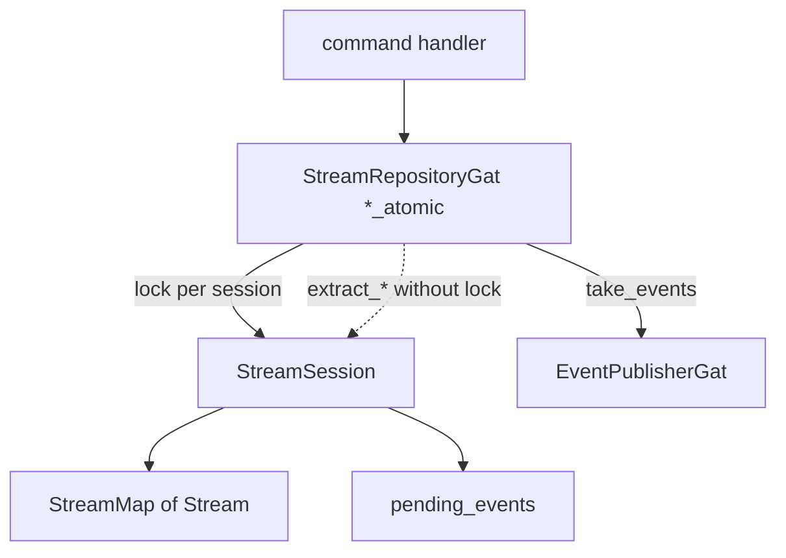

---
aliases:
  - StreamSession Aggregate Plan
tags:
  - sdd
  - plan
  - domain
  - aggregate
created: 2026-11-15
status: implemented
related:
  - "[[053-stream-session-aggregate/spec|spec]]"
code:
  - crates/pjs-core/src/domain/aggregates/stream_session.rs
verified: 2026-11-15
---

# Plan 053: StreamSession Aggregate (as built)

## Architecture
`StreamSession` sits in `pjs-core::domain::aggregates`. It owns `StreamMap` (from `pjs-domain`), a `VecDeque<DomainEvent>`, and an `Arc<dyn TimeProvider>`.

## Design decisions
- Two-phase frame generation (`extract_*` read-only, `commit_*` mutating) so the repository holds its per-session lock only for the commit.
- Events are collected inside the aggregate and drained by the repository inside the same lock, then published by the handler; events are not published from the domain.
- The clock is injected only at the aggregate; child streams use `Utc::now()`.
- Durations use Welford mean plus fixed-alpha EMA; the EMA backs `SessionHealthSnapshot.metrics["recent_avg_duration_ms"]`.
- Session limit is checked by `streams.len()`, not by active count.

## Public API surface
`pjson_rs::StreamSession`, `pjson_rs::domain::aggregates::stream_session::{SessionConfig, SessionStats, SessionHealth, StreamSession}`. Methods: `new`, `with_time_provider`, accessors (`id`, `state`, `config`, `stats`, `created_at`, `updated_at`, `expires_at`, `completed_at`, `client_info`, `duration`, `is_expired`, `is_active`, `streams`, `stream`), mutators listed in spec FR-002..FR-007, `health_check`, `pending_events`, `take_events`.

## Contracts

| Function | Preconditions | Postconditions | Undefined or caller-risk |
|---|---|---|---|
| `activate` | state `Initializing` | state `Active`, `SessionActivated` queued | error otherwise |
| `create_stream` | `is_active()`, below limit | `stats.total_streams` and `active_streams` +1, `StreamCreated` queued | none |
| `complete_stream` | stream `Streaming` | `completed_streams` +1, duration means updated, `StreamCompleted` queued | `duration_ms` uses `num_milliseconds() as f64` |
| `commit_priority_frames` | `is_active()` | sequence numbers assigned only to surviving frames; output sorted by priority desc | stream vanished or no longer `Streaming`: skipped silently |
| `close` | state `Active` | state `Completed`, active streams cancelled, `SessionClosed` queued | `stats.active_streams` not reduced |
| `force_close_expired` | none | `Ok(false)` if not expired; else state `Failed`, streams removed | stats untouched |
| `extend_timeout` | not expired | `expires_at` increased, event queued | `additional_seconds > i64::MAX` wraps (issue #596) |
| `take_events` | `&mut self` | queue empty | events lost if caller drops them |

## Testing strategy
- Unit tests inside `stream_session.rs` (creation, limits, expiry with `ManualTimeProvider`, EMA, extract-then-commit equivalence, stale-commit rejection, `total_bytes`).
- Integration: `crates/pjs-core/tests/stream_session_comprehensive.rs` (fail, force close, health).
- Property/fuzz: none for the aggregate.

## Security notes
Frame generation is bounded by `max_frames`/`batch_size` and the per-stream chunk limit of 5. Session timeouts must be bounded by the caller (issue #596).
