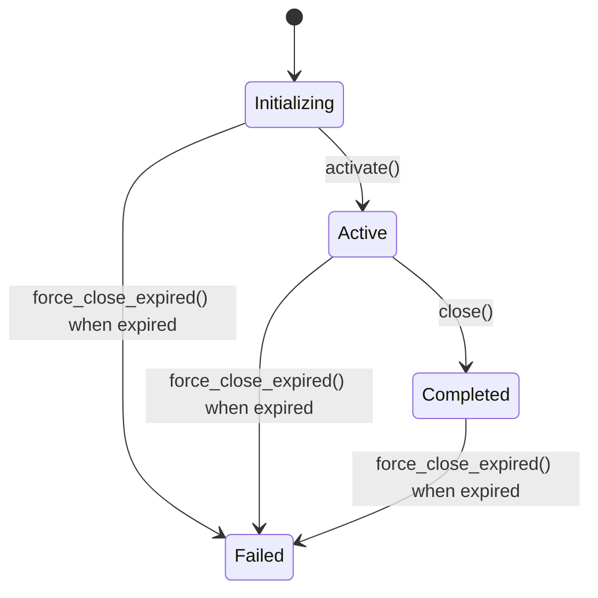

---
aliases:
  - StreamSession Aggregate
  - Session state machine
tags:
  - sdd
  - spec
  - domain
  - aggregate
  - state-machine
created: 2026-11-15
status: implemented
related:
  - "[[constitution]]"
  - "[[MOC-specs]]"
  - "[[052-domain-gat-ports/spec|Domain GAT ports]]"
  - "[[055-application-commands/spec|Application commands]]"
  - "[[032-session-stats-total-bytes-noop/spec|SessionStats total_bytes (032)]]"
code:
  - crates/pjs-core/src/domain/aggregates/stream_session.rs
  - crates/pjs-core/src/domain/aggregates/mod.rs
  - crates/pjs-core/src/domain/config/limits.rs
  - crates/pjs-core/tests/stream_session_comprehensive.rs
  - crates/pjs-domain/src/events/mod.rs
  - crates/pjs-domain/src/entities/stream.rs
verified: 2026-11-15
---

# Spec 053: StreamSession Aggregate

> [!info] Verification (2026-11-15)
> **State: implemented.** `StreamSession` is the aggregate root that owns streams, stats and a pending-event queue. Several methods (`fail_stream`, `force_close_expired`, `extend_timeout`) have no production caller; only tests use them. Timeouts are a bounded `SessionTimeout` (#596) and decoding cross-checks stream ids (#573).

## 1. Overview

### Problem
Session-level invariants (state machine, stream limit, expiry, stats, domain events) must live in one aggregate so that adapters and handlers never mutate child streams directly.

### Goal
Document the verified behaviour of `StreamSession`, `SessionConfig`, `SessionStats`, `SessionHealth` and the interaction with `Stream` and `DomainEvent`.

### Out of scope
- `Stream`/`Frame` entity internals and priority computation (crate `pjs-domain`).
- Persistence ([[052-domain-gat-ports/spec|052]], [[057-in-memory-repositories/spec|057]]).
- Stats aggregation exposed over HTTP ([[056-application-queries-dto/spec|056]]).

## 2. User Stories
- As a handler, I create, start, complete and fail streams through the session and get domain events for each change.
- As an operator, I read counters (`SessionStats`) that match what was emitted.
- As a test author, I inject a clock via `TimeProvider` and get deterministic expiry.

## 3. Functional Requirements

### FR-001 Construction
`StreamSession::new(SessionConfig)` shall create a session in `SessionState::Initializing` with a fresh `SessionId`, `expires_at = now + session_timeout` (`SessionTimeout`, serialised as `session_timeout_seconds`), empty `StreamMap`, empty event queue and default stats. `with_time_provider(config, Arc<dyn TimeProvider>)` shall use the injected clock for session-level timestamps only; child `Stream` entities still read the system clock. `SessionConfig::default()`: 10 concurrent streams, 3600 s timeout, compression on, empty metadata.
Code: `stream_session.rs` (`new`, `with_time_provider`, `SessionConfig`).

### FR-002 State machine
The session shall follow:

- `activate()` shall succeed only from `Initializing` and emit `SessionActivated`; otherwise `DomainError::InvalidStateTransition`.
- `close()` shall succeed only from `Active`, cancel every active stream (best effort), set `Completed`, set `completed_at`, emit `SessionClosed`. `SessionState::Closing` is assigned and overwritten inside the same call and is never observable.
- `force_close_expired()` shall return `Ok(false)` if not expired; otherwise set `Failed` from any state, drain (remove) all streams after cancelling them, emit `SessionTimedOut { original_state, timeout_duration }` and return `Ok(true)`.
- `is_active()` shall be `state == Active && !is_expired()`; `is_expired()` is `now > expires_at`.
Code: `stream_session.rs`. `SessionState` is `#[non_exhaustive]` in `pjs-domain`.

### FR-003 Stream creation and limits
`create_stream(JsonData)` shall require `is_active()` (else `InvalidSessionState`), reject when `streams.len() >= max_concurrent_streams` (`TooManyStreams`), insert a `Stream` using `default_stream_config`, increment `total_streams` and `active_streams`, emit `StreamCreated`. `create_stream_with_config(data, Option<StreamConfig>)` shall additionally apply the config via `update_stream_config` (emits `StreamConfigUpdated`); the second step cannot fail for a fresh `Preparing` stream and is guarded by a `debug_assert!`.
Note: the stream limit counts **all** streams in the map including completed ones, not only active ones.
Code: `create_stream`, `create_stream_with_config`, `update_stream_config`.

### FR-004 Stream lifecycle
- `start_stream(id)`: `Preparing -> Streaming`, emits `StreamStarted`.
- `complete_stream(id)`: `Streaming -> Completed`; `active_streams -= 1` (saturating), `completed_streams += 1`; updates `average_stream_duration_ms` (Welford running mean over completed streams) and `recent_avg_duration_ms` (EMA alpha 0.5, seeded with the first sample); emits `StreamCompleted`. PR #472 added the EMA.
- `fail_stream(id, error)`: from `Preparing`/`Streaming` to `Failed`; `active_streams -= 1`, `failed_streams += 1`; emits `StreamFailed`; does not touch duration stats.
- Unknown id: `DomainError::StreamNotFound`. Invalid transition: `InvalidStateTransition` (from `Stream`).
Code: `start_stream`, `complete_stream`, `fail_stream`.

### FR-005 Frame generation with extract/commit split
The session shall offer a two-phase API so a repository can run the expensive traversal outside a lock:
- Single stream: `extract_prioritized_patches_for_stream(id, threshold)` (read-only, `&self`) then `commit_patch_frames_for_stream(id, patches, max_frames)`; `create_stream_patch_frames` composes both. Commit updates `total_frames`, adds the stream's byte delta to `total_bytes`, emits `FramesBatched` only when frames were produced.
- All streams: `extract_prioritized_patches_for_active_streams(threshold)` (only `Streaming` streams; others silently omitted) then `commit_priority_frames(extracted, batch_size)`; `create_priority_frames` composes both. Commit requires `is_active()` (else `InvalidSessionState`), chunks each stream's patches into at most 5 frames, keeps the `batch_size` highest-priority chunks, assigns sequence numbers only to survivors in each stream's original order, returns frames sorted by priority descending, adds `estimated_size` to `total_bytes`, emits `FramesBatched`.
- `priority_threshold` is an inclusive minimum.
Code: `stream_session.rs`; related issue #506 (sequence assignment only to surviving frames), #472.

### FR-006 Timeout extension and client info
`extend_timeout(additional: SessionTimeout)` shall fail with `InvalidStateTransition` if already expired and with `InvalidInput` if the expiry would overflow, otherwise add the duration to `expires_at` and emit `SessionTimeoutExtended`. `set_client_info(client_info, user_agent, ip_address)` shall store the three optional strings and bump `updated_at`.
Status: done. `SessionTimeout` (`NonZeroU32`, `TryFrom<u64>`, 1..=`MAX_SESSION_TIMEOUT_SECONDS` = 7 days, default 3600 s) makes out-of-range timeouts unrepresentable (#596).

### FR-007 Event queue
Every state-changing method shall append a `DomainEvent` to an internal `VecDeque`. `pending_events()` shall expose it read-only; `take_events()` shall drain it. The queue is part of the serialized aggregate.
Code: `add_event`, `take_events`.

### FR-008 Stats
`SessionStats` fields: `total_streams`, `active_streams`, `completed_streams`, `failed_streams`, `total_frames`, `total_bytes`, `average_stream_duration_ms`, `recent_avg_duration_ms`. `total_bytes` is the sum of `Frame::estimated_size` over emitted frames (counts bytes emitted, so repeated polling of unchanged data re-adds the same bytes). This resolves the dead-field defect described in [[032-session-stats-total-bytes-noop/spec|032]].
Code: `SessionStats`, `commit_*` methods; test `test_create_stream_patch_frames_tracks_total_bytes`.

### FR-009 Health check
`health_check()` shall return `SessionHealth { is_healthy, active_streams, failed_streams, is_expired, uptime_seconds }` where `is_healthy = is_active() && failed_streams == 0`.
Code: `health_check`.

### FR-010 Serialization
`StreamSession` derives `Serialize`/`Deserialize`; the injected `TimeProvider` is `#[serde(skip)]` and restored to `SystemTimeProvider` on decode. `SessionId` uses `pjson_rs_domain::serde_support::session_id`.

## 4. Non-Functional Requirements
- NFR-PERF-001: `commit_priority_frames` cost is proportional to total extracted patches across streams, not to `batch_size` (documented in the method doc). A repository must keep the lock-free `extract_*` outside its lock.
- NFR-TEST-001: all FRs covered by `tests/stream_session_comprehensive.rs` (`ManualTimeProvider`) and unit tests in `stream_session.rs`.

## 5. Data Model
`StreamSession { id, state, config, stats, created_at, updated_at, expires_at, completed_at, streams: StreamMap, pending_events: VecDeque<DomainEvent>, client_info, user_agent, ip_address (all Option<String>), time_provider }`. `StreamState`: `Preparing | Streaming | Completed | Failed | Cancelled` (`#[non_exhaustive]`). `StreamMap` wraps `HashMap<StreamId, Stream>`.

## 6. Edge Cases and Errors

| Case | Result |
|---|---|
| `activate()` when not `Initializing` | `InvalidStateTransition` |
| `create_stream` on expired or non-`Active` session | `InvalidSessionState` |
| `create_stream` at limit | `TooManyStreams` |
| `close()` from `Initializing`, `Completed`, `Failed` | `InvalidStateTransition` |
| `extend_timeout` on expired session | `InvalidStateTransition` |
| `commit_patch_frames_for_stream` for a stream completed since extraction | `InvalidStreamState` (test `test_commit_patch_frames_for_stream_rejects_stream_completed_since_extraction`) |
| Decoded session holding a stream whose `session_id` differs from the session id | rejected at decode (#573) |
| `session_timeout_seconds` 0 or above 604800 | rejected by `SessionTimeout::try_from` (decode error) |

## 7. Success Criteria
- `cargo nextest run -p pjson-rs stream_session` passes.
- `stats.active_streams` equals the number of `Preparing`/`Streaming` streams after create/start/complete/fail sequences (see Open Questions for `close()`).

## 8. Agent Boundaries
- Always: mutate streams only through the aggregate; emit an event for every state change; keep `extract_*` read-only.
- Ask first: changing `SessionConfig` field types (public, serialized); changing event payloads (wire format, `DomainEvent` is tagged JSON).
- Never: call `Stream` mutators from handlers or adapters; bypass `take_events` inside `*_atomic` repository methods.

## 9. Open Questions
- `close()` cancels streams but does not decrement `stats.active_streams`, emit `StreamCancelled`, or count them in `failed_streams`; `force_close_expired()` removes streams but leaves stats unchanged. [NEEDS CLARIFICATION: intended?]
- `fail_stream`, `force_close_expired`, `extend_timeout` and the `SessionExpired` event have no production caller or emitter; nothing sweeps expired sessions (see [[057-in-memory-repositories/spec|057]]).
- `SessionConfig` fields are `pub`; `max_concurrent_streams > 0` is enforced only by `CommandValidator`, while the timeout range is typed.
- `client_info`, `user_agent`, `ip_address` are `Option<String>` (primitive obsession).
- `pending_events` is unbounded if no caller drains it; only `*_atomic` methods and `save_and_publish` drain.
- `max_concurrent_streams` counts finished streams, so a session can become permanently full.

## 10. See Also
[[053-stream-session-aggregate/plan|plan]], [[052-domain-gat-ports/spec|052]], [[055-application-commands/spec|055]], `crates/pjs-domain/src/events/mod.rs` for the 20 `DomainEvent` variants.
