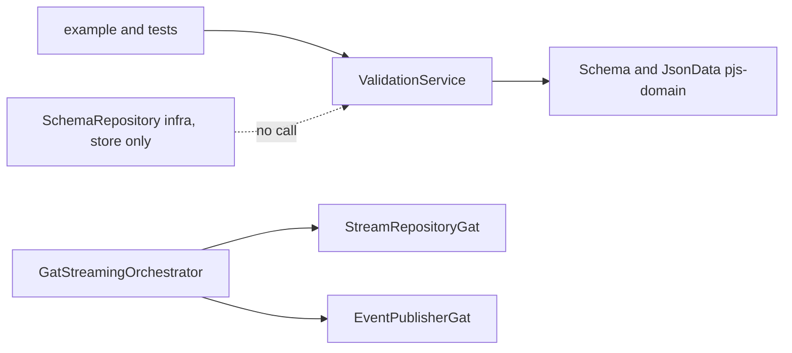

---
aliases:
  - Domain Services Plan
tags:
  - sdd
  - plan
  - domain
created: 2026-11-15
status: partial
related:
  - "[[054-domain-services/spec|spec]]"
code:
  - crates/pjs-core/src/domain/services/validation_service.rs
  - crates/pjs-core/src/domain/services/gat_orchestrator.rs
verified: 2026-11-15
---

# Plan 054: Domain Services (as built)

## Architecture

## Design decisions
- `ValidationService` holds the regex cache as instance state (`DashMap<String, Arc<Regex>>`); one service instance per registry shares compiled patterns.
- First-error semantics keep validation O(n) and bounded; `AllOf` is the only combinator that aggregates.
- The orchestrator is generic over its ports (no `dyn`), requiring `R: 'static`, `P: 'static` and `Self: 'static` on methods because of GAT lifetimes.
- Orchestrator concurrency uses `futures::future::try_join_all`, not spawned tasks.

## Public API surface
`pjson_rs::ValidationService`, `GatStreamingOrchestrator`, `GatOrchestratorFactory`, `OrchestratorConfig`, `HealthStatus` (crate root); `domain::services::gat_orchestrator::StreamingStats` (module path only).

## Contracts

| Function | Preconditions | Postconditions | Undefined or caller-risk |
|---|---|---|---|
| `ValidationService::validate` | none | `Ok` iff data satisfies schema within depth limit | pattern ignored without feature `schema-validation` |
| `with_max_pattern_length(n)` | feature on | stored `min(n, 8 KiB)` | none |
| `stream_with_priority` | session exists | one `StreamCompleted` event published, stats returned | frames not delivered anywhere |
| `process_concurrent_streams` | none | results for first `max_concurrent_streams` inputs | rest dropped; first error aborts all |
| `health_check` | none | probe event published | pollutes event stream |

## Testing strategy
- Unit: 28 tests in `validation_service.rs` (each schema kind, depth, pattern limits, cache bound, realistic pattern corpus); 4 tests in `gat_orchestrator.rs` including `test_gat_orchestrator_concurrent_streams_overlap_in_time`.
- Integration: `tests/schema_validation_integration.rs`; example `examples/schema_validation_demo.rs`.
- No fuzz target for `ValidationService`.

## Security notes
Regex DoS controls (FR-003), depth bound (FR-007). Error values embed the pattern and offending value; both are bounded by the pattern-length check, the value is not truncated.
