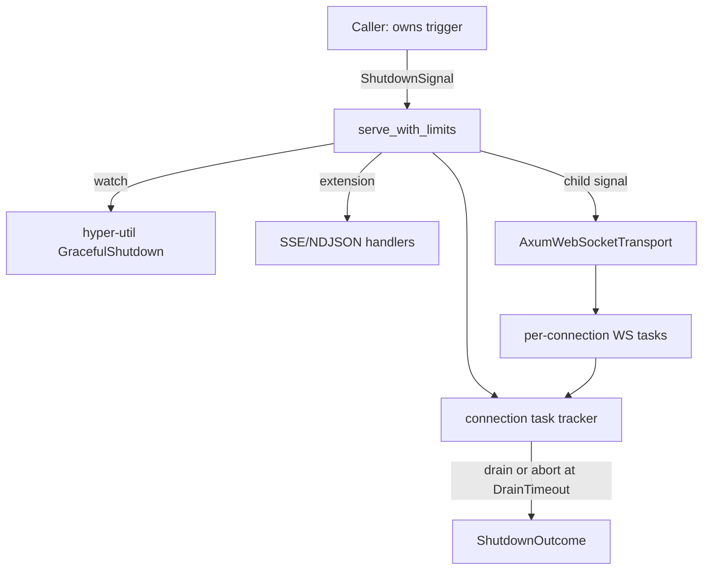

---
aliases:
  - Graceful Shutdown Plan
tags:
  - sdd
  - plan
  - http
  - websocket
created: 2026-11-15
status: draft
issue: "#590"
related:
  - "[[037-graceful-shutdown-serve-with-limits/spec|spec]]"
  - "[[037-graceful-shutdown-serve-with-limits/tasks|tasks]]"
  - "[[constitution]]"
verified: 2026-11-15
---

# Technical Plan: Graceful Shutdown for serve_with_limits

> [!info] References
> **Spec**: [[037-graceful-shutdown-serve-with-limits/spec|spec]]
> **Verified 2026-11-15**: plan assumptions checked against `serve.rs` and `websocket/server.rs` at HEAD `dcf9b11`; nothing implemented yet (issue #590 open). `tokio-util` is not yet a dependency and hyper-util lacks the `server-graceful` feature.

## 1. Architecture

### Approach
Add a typed `ShutdownSignal` (cancellation handle) and `DrainTimeout` newtype under `infrastructure/http/`. `serve_with_limits` races its semaphore acquire and `accept_with_retry` against the signal. Each connection is driven through `hyper_util::server::graceful::GracefulShutdown::watch` (HTTP/1 and HTTP/2, including upgradeable connections), so `shutdown()` sends GOAWAY / `Connection: close`. After the signal, the loop waits for `GracefulShutdown::shutdown()` bounded by `DrainTimeout`; on expiry the remaining connection tasks (held in a tracked set) are aborted and counted.

Hyper stops tracking a connection after an HTTP upgrade, so WebSocket handlers need their own path: `AxumWebSocketTransport` gets a child `ShutdownSignal`; each `handle_socket` task selects on it, sends Close(1001), and is registered in the same tracker so the drain waits for it. Streaming handlers receive the signal through a request extension (inserted per connection next to `ConnectInfo`) so they can emit a terminal frame (FR-008, format pending).

### Component Diagram



### Key Design Decisions

| Decision | Choice | Rationale | Alternatives Considered |
|----------|--------|-----------|------------------------|
| HTTP drain | hyper-util `GracefulShutdown` (feature `server-graceful`) | Same primitive axum uses; handles GOAWAY and keep-alive | Hand-rolled per-connection `graceful_shutdown()` calls: more code, same result |
| Cancellation primitive | `tokio_util::sync::CancellationToken` wrapped in `ShutdownSignal` | Cloneable, child tokens for WS, race-free | `tokio::sync::watch<bool>`: no new dependency but no child hierarchy; viable fallback |
| Task tracking | `tokio_util::task::TaskTracker` | Wait-for-all with count; avoids hand-rolled JoinSet | `JoinSet` in the accept loop (no dep, but WS tasks live elsewhere) |
| Entry point | Single `serve_with_limits(listener, router, limits, ShutdownConfig)` | Pre-1.0 clean API, no duplicate paths (DRY) | Sibling fn + delegating wrapper: non-breaking, extra surface [NEEDS CLARIFICATION: see spec open question] |
| Public types | `ShutdownSignal`, `DrainTimeout`, `ShutdownOutcome` (enum) | Type safety: no raw Duration/bool/usize tuples | `impl Future<Output=()>` param: loses child derivation and typing |
| Abort policy | Abort remaining tasks at deadline, report count | Bounded exit (NFR-SEC-001) | Wait forever: rejected |

## 2. Project Structure

```
crates/pjs-core/src/infrastructure/
├── http/
│   ├── serve.rs          # modified: loop, drain, outcome
│   ├── shutdown.rs       # new: ShutdownSignal, DrainTimeout, ShutdownOutcome
│   └── mod.rs            # re-exports
├── websocket/server.rs   # modified: observe child signal, Close(1001), tracker
crates/pjs-core/tests/http_graceful_shutdown.rs   # new
crates/pjs-demo/src/servers/*.rs                  # adopt new signature
CHANGELOG.md                                      # breaking-change entry
```

## 3. Data Model

Shapes only (no implementation):

- `ShutdownSignal`: `Clone`; `trigger(&self)`, `is_triggered(&self) -> bool`, `async cancelled(&self)`, `child(&self) -> ShutdownSignal`.
- `DrainTimeout`: newtype over `Duration`; `TryFrom<Duration>` rejects zero and values above the max cap; `Default` = [NEEDS CLARIFICATION: 30 s]; error enum `InvalidDrainTimeout { Zero, TooLarge }`.
- `ShutdownConfig { signal: ShutdownSignal, drain_timeout: DrainTimeout }`.
- `ShutdownOutcome`: `Drained` | `Forced { aborted: NonZeroUsize }`.

## 4. API Design

| Item | Change | Notes |
|------|--------|-------|
| `serve_with_limits` | gains `ShutdownConfig` param, returns `io::Result<ShutdownOutcome>` | breaking; CHANGELOG |
| `AxumWebSocketTransport` | builder method accepting a `ShutdownSignal` | infrastructure-only |
| Request extension | `ShutdownSignal` inserted per connection | readable by streaming handlers |

## 5. Integration Points

| System | Direction | Protocol | Notes |
|--------|-----------|----------|-------|
| hyper-util `server-graceful` | inbound dep feature | in-process | enable feature on existing dep |
| tokio-util | new dep (ask-first) | in-process | verify current version via context7 before adding; features `rt` for TaskTracker |
| Demo servers | caller | in-process | adopt signature, wire Ctrl-C |

## 6. Security

- All drain waits bounded by `DrainTimeout` (validated cap); slow readers cannot extend it.
- After the signal, accept stops; semaphore and per-IP guards are released as connections end, preserving accounting.
- No iteration over untrusted input is introduced; abort count is bounded by `max_connections`.
- Close reason text is static (no peer-controlled data).

## 7. Testing Strategy

| Level | Framework | What to Test | Coverage Target |
|-------|-----------|-------------|-----------------|
| Unit | nextest | `DrainTimeout` validation, `ShutdownSignal` idempotence/child propagation | 100% of new module |
| Integration | nextest, real TcpListener | idle server shutdown returns `Drained`; in-flight NDJSON finishes; stalled client aborted at deadline with `Forced`; post-signal connect not served; pre-fired signal returns immediately | all FR-001..005, 009, 010 |
| WebSocket | tokio-tungstenite client | Close code 1001 received | FR-003 |
| Time | `tokio::time::pause` | drain deadline without wall-clock sleeps | FR-004 |
| Leak | task tracker count | zero tasks after return | NFR-REL-001 |
| Bench | `cargo bench -p pjs-bench` | accept path delta < 2% | NFR-PERF-001 |

## 8. Performance Considerations

- Hot path adds one `select!` branch on a cancellation future per accept and one token clone per connection.
- `watch` wraps each connection future once; no per-frame cost.
- Must not touch GAT ports or priority queue (critical paths).

## 9. Rollout Plan

Single PR, breaking change noted in CHANGELOG `[Unreleased]` (pre-1.0). Demo servers updated in the same PR. Doc update on the `serve_with_limits` rustdoc (remove "runs until the process is torn down").

## 10. Constitution Compliance

Checked against [[constitution]] and CLAUDE.md rules.

| Principle | Status | Notes |
|-----------|--------|-------|
| Hexagonal layering | Compliant | all types in `infrastructure/` |
| Type safety / newtypes | Compliant | `DrainTimeout`, `ShutdownSignal`, enum outcome |
| Bounded untrusted iteration | Compliant | drain deadline, abort count bounded |
| `///` docs + doc-tests | Planned | every new pub item |
| No `unwrap` on reachable paths | Planned | review gate |
| New dependency justification | Pending | tokio-util ask-first |

## 11. Risks and Mitigations

| Risk | Impact | Probability | Mitigation |
|------|--------|-------------|------------|
| Hyper does not track upgraded connections | high | high | separate WS signal and shared tracker (designed in) |
| Terminal frame format undefined | med | high | [NEEDS CLARIFICATION: format]; ship FR-008 as extension-only hook first |
| `max_connection_duration` `timeout` wrapping interacts with `watch` | med | med | wrap the watched future; covered by test |
| Breaking signature affects demos/tests (`http_serve_connection_limits.rs`, axum_adapter.rs) | low | high | update call sites in the same PR |
| New dependency tokio-util | low | med | fallback to `watch` + `JoinSet` |
| Permit acquire blocks shutdown observation | med | med | race acquire with signal (edge case table) |
| Aborting tasks drops per-IP guards late | low | low | guards are RAII, released on task drop |

## 12. Contracts

| Item | Preconditions | Postconditions | Undefined behaviour |
|------|---------------|----------------|---------------------|
| `serve_with_limits(listener, router, limits, shutdown)` | listener bound; Tokio runtime with time enabled | Ok(`Drained`) if all connections ended before the deadline; Ok(`Forced{n}`) if n were aborted; no accept after signal; no task outlives return; Err only on a non-retryable listener failure | signal never triggered and no exit (runs forever, as today); runtime without the time driver |
| `DrainTimeout::try_from(Duration)` | none | Ok iff 0 < d <= cap | none |
| `ShutdownSignal::trigger` | none | `is_triggered()` true; all clones and children observe; idempotent | none |
| `ShutdownSignal::child` | none | child triggers when parent triggers; child trigger does not affect parent | none |
| WS handler on signal | connection established | Close(1001) attempted within the write timeout, then task ends | peer that never acks the close: bounded by drain deadline |
| Streaming handler terminal frame | signal available in request extensions | handler may end stream with terminal frame | frame format [NEEDS CLARIFICATION] |

## 13. Open Questions (carried from spec)

> [!question]
> - [NEEDS CLARIFICATION: terminal frame wire format for SSE/NDJSON]
> - [NEEDS CLARIFICATION: default and max `DrainTimeout`]
> - [NEEDS CLARIFICATION: break signature vs sibling function]
> - [NEEDS CLARIFICATION: dropped-trigger semantics]
> - [NEEDS CLARIFICATION: standalone WS transport shutdown outside `serve_with_limits`]
> - [NEEDS CLARIFICATION: tokio-util vs `watch`+`JoinSet` (dependency approval)]
> - [resolved: issue is #590]

## See Also

- [[037-graceful-shutdown-serve-with-limits/spec|spec]] — feature specification
- [[037-graceful-shutdown-serve-with-limits/tasks|tasks]] — implementation tasks
- [[MOC-specs]] — all specifications
