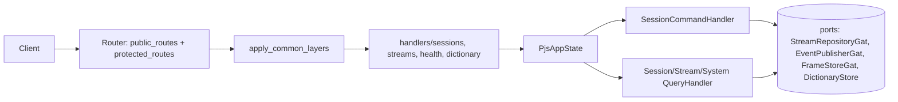

---
aliases:
  - HTTP REST API plan
tags:
  - sdd
  - plan
  - http
created: 2026-11-15
status: implemented
related:
  - "[[060-http-rest-api/spec|060 spec]]"
  - "[[constitution]]"
code:
  - crates/pjs-core/src/infrastructure/http/axum_adapter.rs
  - crates/pjs-core/src/infrastructure/http/handlers/
verified: 2026-11-15
---

# Plan (as-built): HTTP REST API

## Architecture

Handlers are thin: parse path/query into domain newtypes, build an application command/query, dispatch through `CommandHandlerGat`/`QueryHandlerGat`, map `ApplicationError` into `PjsError`. No domain rules live in `infrastructure/http` apart from default values (10 streams, 3600 s, 16 frames).

## Design decisions

- Router split into `public_routes` (health, metrics) and `protected_routes` so auth wraps only the latter with no path-string comparison in the auth layer (`create_pjs_router_with_auth`).
- Handlers split by resource under `handlers/` (issue #316); parse helpers `parse_session_id`, `parse_session_and_stream_id`, `parse_session_state`, `parse_sort_field`, `parse_sort_order` are `pub(crate)` in `axum_adapter.rs` (issue #320).
- Query enums are parsed from raw strings through serde so errors use the JSON envelope.
- `HttpServerConfig` is `#[non_exhaustive]` to add fields without breaking callers.
- Default `F = InMemoryFrameStore` keeps `PjsAppState<R, P, S>` the common type.

## Public API surface

`infrastructure::http` re-exports: `create_pjs_router`, `create_pjs_router_with_config`, `create_pjs_router_with_rate_limit`, `create_pjs_router_with_rate_limit_and_config`, `create_pjs_router_with_auth`, `create_pjs_router_with_rate_limit_and_auth` (last two `http-server`), `PjsAppState`, `HttpServerConfig`, `PjsError`, `CreateSessionRequest`, `CreateSessionResponse`, `StartStreamRequest`, `StreamParams`.

## Contracts

| Function | Precondition | Postcondition | Undefined / notes |
|---|---|---|---|
| `create_pjs_router_with_config(cfg)` | `cfg.allowed_origins` not a `*`/explicit mix, all parseable | `Ok(router)` with the FR-001 routes plus the common layers | Invalid origins return `Err(PjsError::HttpError)`; never panics |
| `create_pjs_router_with_auth(cfg, auth)` | as above | health and metrics unauthenticated, all else behind `auth` | Auth is only `ApiKeyAuthLayer`; JWT layer is not accepted by constructors |
| `create_pjs_router_with_rate_limit*` | served with `into_make_service_with_connect_info::<SocketAddr>()` or `serve_with_limits` | per-IP quota applied | Without `ConnectInfo`, all clients share one bucket (127.0.0.1) and a one-time warning is logged |
| `PjsAppState::new(repo, pub, store)` | none | dictionary store is `NoopDictionaryStore`, frame store `InMemoryFrameStore` | Records process start time for uptime stats |
| `PjsError::into_response` | none | JSON `{"error": msg}` plus status per FR-007 | - |

## Testing strategy

- `crates/pjs-core/tests/http_axum_endpoints.rs` (route behaviour), `http_dto_serialization.rs` (DTO shapes), `http_streaming_comprehensive.rs`.
- Unit tests in `axum_adapter.rs`: CORS construction (empty, wildcard, mixed, invalid), metrics route presence, error mapping.
- Dictionary handler tests live inside `handlers/dictionary.rs` with mock repository/store.
- No fuzz target covers HTTP DTOs.

## Security notes

- Path ids and enum-like query values are validated before reaching handlers' domain calls.
- Error bodies use fixed generic text for internal failures (dictionary load, streaming response build).
- Auth and rate-limit ordering rationale: see [[061-http-middleware-stack/spec|061]].
