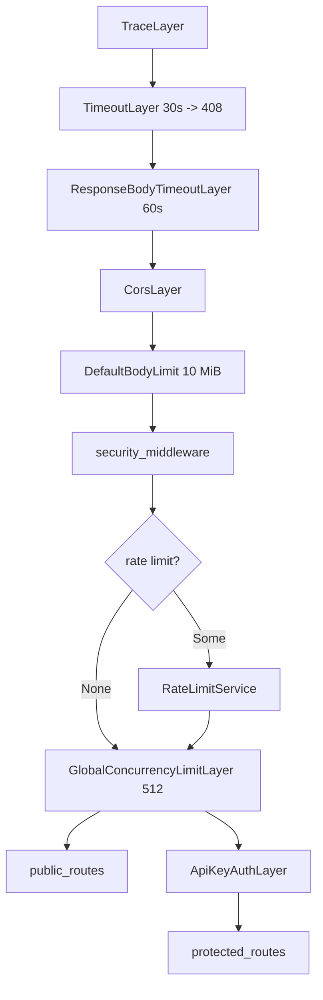

---
aliases:
  - HTTP middleware stack plan
tags:
  - sdd
  - plan
  - http
  - security
created: 2026-11-15
status: partial
related:
  - "[[061-http-middleware-stack/spec|061 spec]]"
  - "[[constitution]]"
code:
  - crates/pjs-core/src/infrastructure/http/axum_adapter.rs
  - crates/pjs-core/src/infrastructure/http/middleware.rs
  - crates/pjs-core/src/infrastructure/http/auth.rs
verified: 2026-11-18
---

# Plan (as-built): HTTP middleware stack

## Architecture

## Design decisions

- `GlobalConcurrencyLimitLayer` instead of `ConcurrencyLimitLayer`: axum clones a layer once per route, and the plain layer would create a semaphore per route (issue #515 context, documented on `MAX_CONCURRENT_REQUESTS`).
- Rate limit applied inside security/CORS/trace so 429s remain browser-readable and traced; an earlier outermost placement regressed this.
- Auth wraps only `protected_routes`; `/pjs/health` and `/metrics` stay public; the layer's `OPTIONS` bypass is defensive since CORS answers preflight first.
- Per-process random HMAC seed means key tags are not comparable across processes and never persisted.
- Trusted-proxy parsing fails closed on the first unparseable `X-Forwarded-For` entry rather than guessing.
- Reject-new at `MAX_TRACKED_CLIENTS` (503) protects established clients' state over new-client admission (documented trade-off in `security::rate_limit`).

## Public API surface

`RateLimitMiddleware`, `TrustedProxyConfig` (re-exported from `infrastructure::http`); `middleware::{PjsMiddleware, compression_middleware, security_middleware, health_check_middleware, websocket_upgrade_middleware, CircuitBreakerMiddleware, ContentValidationConfig, content_validation_middleware}` (module-public only); `auth::{ApiKeyConfig, ApiKeyAuthLayer, ApiKeyAuthService, AuthConfigError}` and with `http-auth-jwt` `{JwtConfig, JwtAuthLayer, JwtAuthService}`.

## Contracts

| Function | Precondition | Postcondition | Undefined / notes |
|---|---|---|---|
| `ApiKeyConfig::new(keys)` | non-empty, no ASCII whitespace in any key | tags computed under fresh seed | RNG failure returns `RngFailure` |
| `ApiKeyAuthService::call` | request | forwards iff token matches any key or method is `OPTIONS`; else 401 JSON | Token read from first matching header source only |
| `RateLimitMiddleware::new(cfg)` | ideally inside a Tokio runtime | limiter plus cleanup task | Outside a runtime, pruning is skipped with a warning |
| `extract_client_ip` | request extensions | peer IP, or forwarded IP only if peer is trusted | No `ConnectInfo` gives 127.0.0.1 |
| `security_middleware` | any response | three headers set | Overwrites handler-set values |

## Testing strategy

- `tests/http_rate_limiting_integration.rs`: headers, 429 body, window reset, XFF/X-Real-IP handling, concurrency.
- `tests/http_middleware_comprehensive.rs`, `http_middleware_tests.rs`: middleware types and security headers.
- Unit tests in `auth.rs` (timing-safe matching design, preflight, headers) and `middleware.rs`.
- `axum_adapter.rs` unit tests cover router construction variants.
- No benchmark for the stack; `crates/pjs-bench/benches/http_streaming.rs` targets streaming only.

## Security notes

- CWE-942 style CORS wildcard is opt-in only; credentials mode is never enabled.
- Request-size defence is the 10 MiB `DefaultBodyLimit`; there is no explicit header-size cap (issue #618).
- Reverse-proxy deployments must configure `TrustedProxyConfig` for correct per-client limiting.
