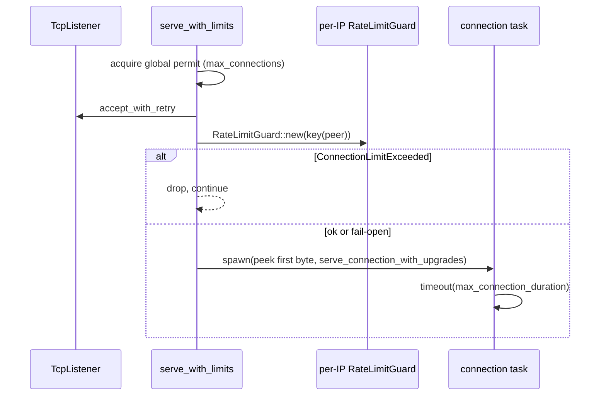

---
aliases:
  - serve_with_limits plan
tags:
  - sdd
  - plan
  - http
created: 2026-11-15
status: implemented
related:
  - "[[062-http-serve-connection-limits/spec|062 spec]]"
  - "[[constitution]]"
code:
  - crates/pjs-core/src/infrastructure/http/serve.rs
verified: 2026-11-15
---

# Plan (as-built): `serve_with_limits`

## Architecture

## Design decisions

- Own the accept loop because tower layers cannot see socket stalls.
- Permit acquired before `accept()` so a full pool backpressures at the loop, not inside hyper.
- `max_concurrent_streams` gated: hyper's `None` means "unlimited", opposite to this field's `None`.
- `peek` instead of `readable()` because tokio >= 1.54 reports fresh sockets readable.
- Fail open on non-cap limiter errors to avoid total lockout when the limiter table fills.
- /64 masking prevents rotation within a routed prefix.

## Public API surface

`ConnectionLimits`, `serve_with_limits` (re-exported from `infrastructure::http` and `infrastructure`).

## Contracts

| Function | Precondition | Postcondition | Undefined / notes |
|---|---|---|---|
| `serve_with_limits(listener, router, limits)` | bound listener; Tokio runtime; router state already supplied (`Router<()>`) | serves until process end | Returns `io::Result` but has no normal exit; per-connection errors never propagate |
| `accept_rate_limit_key(ip)` | any IP | key per FR-004 | Pure |
| `ConnectionLimits::default()` | none | values in FR-001 | `#[non_exhaustive]`: construct via default then mutate fields |

## Testing strategy

`crates/pjs-core/tests/http_serve_connection_limits.rs` uses real sockets; unit tests in `serve.rs` (6) cover key masking and error classification. No fuzz or bench.

## Security notes

Defaults chosen for slowloris and non-reading-client mitigation; the reverse-proxy and WebSocket caveats in `ConnectionLimits` rustdoc are part of the contract.
