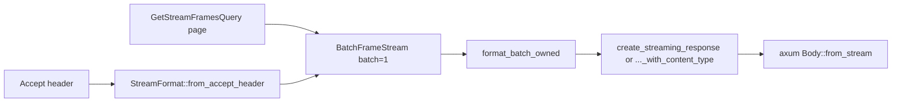

---
aliases:
  - HTTP streaming plan
tags:
  - sdd
  - plan
  - http
  - streaming
created: 2026-11-15
status: implemented
related:
  - "[[063-http-streaming-negotiation/spec|063 spec]]"
  - "[[constitution]]"
code:
  - crates/pjs-core/src/infrastructure/http/streaming.rs
  - crates/pjs-core/src/infrastructure/http/handlers/streams.rs
verified: 2026-11-15
---

# Plan (as-built): HTTP streaming and negotiation

## Architecture

Negotiation pipeline: split by `,` (take 16) -> per-entry media-range check (only `*/*`, `application/*` wildcards) -> `q` sanitise (`format_q`, clamp, drop non-finite) -> per-entry `MediaTypeBuf` validation -> `Accept::from_str` -> `negotiate(SUPPORTED_MEDIA_TYPES)`.

## Design decisions

- NDJSON-of-objects for both `Json` and `NdJson` (issue #167) so the body is incrementally parseable; `Json` is promoted to the NDJSON content type rather than advertising a non-document as `application/json`.
- Stream item type is `Vec<u8>` (not `String`) to leave room for per-batch compression (#226).
- Page materialised before streaming; honest about not being a live tail (route rustdoc).
- No `Connection`/`Transfer-Encoding` headers (hyper owns framing; HTTP/2 legality).
- `X_NDJSON` declared locally because `mediatype` lacks a registry constant.

## Public API surface

`StreamFormat` (`from_accept_header`, `content_type`), `BatchFrameStream` (`new`, `content_type`, `into_stream`), `StreamTransportError`, `create_streaming_response`, `create_streaming_response_with_content_type`.

## Contracts

| Function | Precondition | Postcondition | Undefined / notes |
|---|---|---|---|
| `StreamFormat::from_accept_header(h)` | any `HeaderMap` | total function, never panics, returns `Json` fallback | At most 16 entries examined |
| `BatchFrameStream::new(s, f, n)` | `S: Stream<Item = Frame> + Unpin + Send + 'static` | no I/O until polled | `n == 0` yields a batch per frame, since `len() >= 0` holds after the first push [NEEDS CLARIFICATION: no explicit guard] |
| `into_stream()` | none | batches in order, last partial flushed; serialization error ends stream with `Err` | NaN/Infinity cannot occur in `Frame` (`JsonData` rejects them) |
| `create_streaming_response*` | stream of `Result<Vec<u8>, _>` | `200` with headers per FR-005 | Builder error becomes `StreamTransportError::Io` |

## Testing strategy

`tests/http_streaming_comprehensive.rs`; unit tests in `streaming.rs`; `crates/pjs-bench/benches/http_streaming.rs`; route behaviour in `tests/http_axum_endpoints.rs`. No fuzz target for `Accept` parsing despite untrusted input.

## Security notes

Untrusted `Accept` is bounded and sanitised before reaching a third-party parser that would otherwise fail the whole header on one bad entry and does not cap entries.
