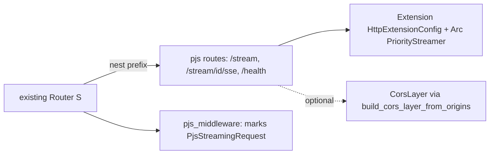

---
aliases:
  - PjsExtension plan
tags:
  - sdd
  - plan
  - http
created: 2026-11-15
status: partial
related:
  - "[[064-http-axum-extension/spec|064 spec]]"
  - "[[constitution]]"
code:
  - crates/pjs-core/src/infrastructure/http/axum_extension.rs
verified: 2026-11-15
---

# Plan (as-built): `PjsExtension`

## Architecture

## Design decisions

- State is injected with `Extension` layers rather than router state, so the extension composes with any `Router<S>` where `S: Clone + Send + Sync + 'static`.
- CORS shared with `axum_adapter::build_cors_layer_from_origins` to keep one validated allow-list implementation.
- Fail-closed on invalid CORS config (log, no layer) because the builder returns the router, not a `Result`.
- `PriorityStreamer` is held in an `Arc` and reused across requests.

## Public API surface

`HttpExtensionConfig`, `PjsExtension` (`new`, `extend_router`), `PjsStreamingRequest`, `StreamRequest`, `StreamResponse`, `StreamExtensionError`, `PjsResponseExt`, macro `pjs_endpoint!`. Re-exported from `infrastructure::http`: `HttpExtensionConfig`, `PjsExtension`.

## Contracts

| Function | Precondition | Postcondition | Undefined / notes |
|---|---|---|---|
| `PjsExtension::new(cfg)` | none | creates a `PriorityStreamer` | - |
| `extend_router(r)` | `cfg.route_prefix` valid for `Router::nest` | routes mounted under prefix, middleware applied to the whole router | An invalid prefix panics inside axum `nest` [NEEDS CLARIFICATION: not validated here] |
| `handle_stream_request` | JSON body | 201 plus `Location`; no persistence | `estimated_frames` from `plan.frames().count()` |
| `handle_sse_stream` | any id | sample-data SSE | Panics only if a `Frame` fails to serialise (considered unreachable) |

## Testing strategy

`tests/http_axum_extension_comprehensive.rs`; two unit tests in `axum_extension.rs`. No fuzz or bench.

## Security notes

CWE-942 mitigation: default no CORS header; operator-supplied allow-list only. No auth or rate limiting is applied by the extension; the host application owns those.
