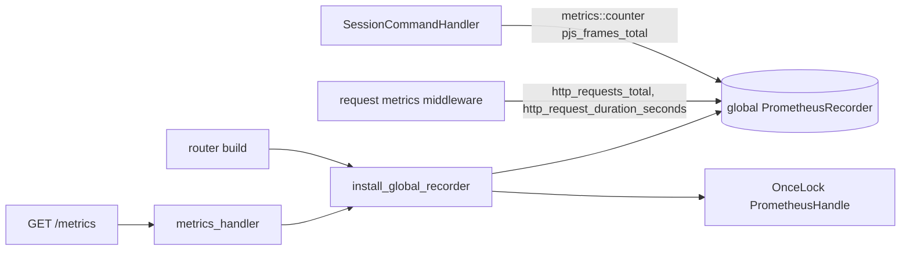

---
aliases:
  - Prometheus metrics plan
tags:
  - sdd
  - plan
  - metrics
created: 2026-11-15
status: partial
related:
  - "[[065-http-prometheus-metrics/spec|065 spec]]"
  - "[[constitution]]"
code:
  - crates/pjs-core/src/infrastructure/http/metrics.rs
verified: 2026-11-15
---

# Plan (as-built): Prometheus metrics

## Architecture

## Design decisions

- Process-global recorder behind `OnceLock::get_or_try_init` (nightly `once_cell_try`): success cached, failure retried.
- Eager install at router build time (`apply_common_layers`), so requests before the first scrape are counted; the handler keeps a retrying install as a fallback.
- `MethodLabel` closed enum bounds the `method` label; `route` uses `MatchedPath`.
- Session/stream gauges are set at scrape time (no lifecycle deltas, so no drift); the 1 s throttle is per `PjsAppState`, not global.
- Emission sites are gated with `cfg(feature = "metrics")`; WebSocket-only items also with `websocket-server`.
- Upkeep task spawned from the install closure when a Tokio runtime is current.
- Error log guarded by `Once` to avoid ERROR flooding on an unauthenticated route.

## Public API surface

`infrastructure::http::metrics::{install_global_recorder, metrics_handler}` (module `pub`, feature `metrics`).

## Contracts

| Function | Precondition | Postcondition | Undefined / notes |
|---|---|---|---|
| `install_global_recorder()` | none | `Ok(handle)` same recorder each call | Fails if a different global `metrics` recorder is installed |
| `metrics_handler::<R, P, S>(State<PjsAppState>)` | none | 200 text exposition, or 500 fixed text | Never exposes install error text |

## Testing strategy

`install_is_idempotent` (unit); `axum_adapter.rs` route tests under `#[cfg(feature = "metrics")]`.

## Security notes

Unauthenticated by design (public route group); relies on deployment isolation.
