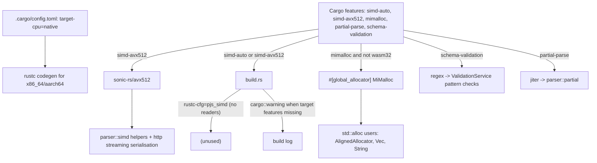

---
aliases:
  - SIMD Features and Allocator Plan (as built)
tags:
  - sdd
  - plan
  - simd
  - allocator
created: 2026-11-15
status: implemented
related:
  - "[[041-simd-features-and-global-allocator/spec]]"
verified: 2026-11-15
---

# Plan 041: SIMD Features and Global Allocator (as built)

Spec: [[041-simd-features-and-global-allocator/spec|041]]. Index: [[MOC-specs]].

## Architecture

## Design decisions

- SIMD is delegated to `sonic-rs`; the project has no intrinsics of its own. The three per-ISA flags were collapsed because they selected nothing different (CHANGELOG 0.6.3 Removed).
- The allocator is a compile-time choice (`mimalloc` feature) rather than a runtime one; `global_allocator_name()` exists for diagnostics and benchmark labels.
- `target-cpu=native` is set repo-wide so local benches exercise the SIMD paths; releases override via `RUSTFLAGS`.
- `build.rs` warns rather than errors, because a missing target feature only degrades speed.

## Public API surface

`pjson_rs::global_allocator_name`, `pjson_rs::parser::simd::{SimdClassifier, SimdNumericOps, ValueClass, KeyScanResult, ArrayStats}`; no feature-gated public items other than `parser::partial` and the allocator static (private).

## Contracts

| Function | Preconditions | Postconditions | Undefined / notes |
|---|---|---|---|
| `global_allocator_name()` | none | `"mimalloc"` iff feature `mimalloc` and not wasm32, else `"system"` | reflects compile-time cfg, not the allocator actually linked by a foreign crate |
| `SimdClassifier::classify_value_type(v)` | valid `sonic_rs::Value` | exactly one `ValueClass` | unknown kinds map to `Null` |
| `SimdClassifier::is_numeric_array(arr)` | none | `true` iff `len >= 3` and every element is a number | |
| `SimdClassifier::scan_object_keys(obj)` | none | flags set iff a matching key exists; `key_count == obj.len()` | key match is exact bytes |
| `SimdNumericOps::fast_array_sum(arr)` | none | `Some(sum)` when at least one `f64`-convertible number and all elements are numbers | `None` on any non-number |
| `SimdNumericOps::array_stats(arr)` | none | `Some(ArrayStats)` with `count > 0` | `None` on any non-number or no values |
| `ArrayStats::mean()` | none | `sum / count`, `0.0` when `count == 0` | |

## Testing strategy

- `tests/parser_simd_classifier_comprehensive.rs` and module unit tests for classifier/numeric helpers.
- `tests/parser_allocator_comprehensive.rs` for `global_allocator_name`.
- CI matrix `system` x `mimalloc` on ubuntu, macOS, windows ([[078-ci-pipeline/spec|078]]); coverage job with `--all-features` builds `mimalloc`, `partial-parse`, `simd-avx512` together.
- `simd-avx512` is compile-tested by the all-features clippy and coverage jobs only; no job runs on AVX-512 hardware `[NEEDS CLARIFICATION]`.

## Security notes

- `sonic-rs` has no internal recursion limit (see `config/security.rs` `MAX_SAFE_JSON_DEPTH`); any new direct `sonic_rs::from_*` on untrusted input must first call the shared depth validator (`SecurityValidator::validate_json_depth_bytes`). Today `sonic-rs` is only used for serialisation in production code.
- A global allocator swap changes process-wide memory behaviour; mimalloc is third-party C code linked into the binary.
