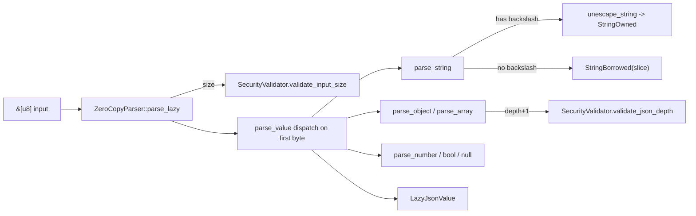

---
aliases:
  - Zero-Copy Parser Plan (as built)
tags:
  - sdd
  - plan
  - parser
created: 2026-11-15
status: implemented
related:
  - "[[038-zero-copy-lazy-json-parser/spec]]"
verified: 2026-11-15
---

# Plan 038: Zero-Copy Lazy JSON Parser (as built)

Spec: [[038-zero-copy-lazy-json-parser/spec|038]]. Index: [[MOC-specs]].

## Architecture

`ZeroCopyParser` is a recursive-descent validator over a byte slice. It keeps a cursor (`position`), a nesting counter (`depth`) and a `SecurityValidator` built from a `ValidatedSecurityConfig`. Values are never built; the parser returns slices of the input.

Dependencies: `crate::config::ValidatedSecurityConfig`, `crate::security::SecurityValidator`, `crate::domain::{DomainError, DomainResult}` (re-export of the domain crate error), `parser::ValueType`.

## Design decisions

- Recursion on the Rust stack is acceptable because depth is capped by `max_depth` (config ceiling 512, default 64).
- Object keys and values are parsed through `parse_value` and discarded; only the container span is returned. This keeps validation complete while avoiding any per-child storage.
- Unescaping allocates a `Vec<u8>` and converts to `String`, so invalid UTF-8 produced by `\u` handling cannot occur, but raw invalid bytes in an escaped string are caught only at `String::from_utf8`.
- The parser has no SIMD path; the `simd-*` features do not affect it.

## Public API surface

`pjson_rs::parser::{LazyParser, ZeroCopyParser, LazyJsonValue, MemoryUsage, IncrementalParser, ValueType}`; crate-root `LazyParser`, `ZeroCopyParser`.

## Contracts

| Function | Preconditions | Postconditions | Undefined / notes |
|---|---|---|---|
| `ZeroCopyParser::parse_lazy(&mut self, input)` | `input` outlives `'a` | on `Ok`, value spans lie within `input`; `position` is one past the value; `depth` back to 0 | trailing bytes are left in `remaining()`; on `Err` the cursor is unspecified until the next `parse_lazy`/`reset` |
| `ZeroCopyParser::parse_value` | `input` set by a prior `parse_lazy` | same as above | calling it before `parse_lazy` sees an empty input and returns `InvalidInput` |
| `LazyJsonValue::as_str` | variant is `StringBorrowed` or `StringOwned` | `Ok(&str)` borrowed from input / owned buffer | `InvalidInput` on non-string or invalid UTF-8 |
| `LazyJsonValue::as_number` | variant is `NumberSlice` | `f64` via `str::parse` | large exponents yield `inf`; no precision guarantee for big integers |
| `LazyJsonValue::as_bytes` | none | `Some` for borrowed variants, `None` for `StringOwned`, `Boolean`, `Null` | |
| `IncrementalParser::parse_available` | none | always `Ok(vec![])` | stub |

## Testing strategy

- Unit tests in `zero_copy.rs` (scalars, escapes, surrogates, depth, size limits, reset/reuse).
- Integration: `crates/pjs-core/tests/zero_copy_integration_test.rs` (async tests covering basic parse, string/escape allocation behaviour, buffer pool integration, efficiency comparison, reuse, incremental).
- Fuzz: `fuzz/fuzz_targets/parser_zero_copy.rs`.
- Bench: `crates/pjs-bench/benches/zero_copy_bench.rs`.
- Example: `crates/pjs-core/examples/zero_copy_demo.rs` (`required-features = []`).

## Security notes

- CWE-674 mitigation is the depth check; there is no other recursion.
- CWE-770: the only allocation driven by input is `unescape_string` (bounded by the string length, which is bounded by `max_input_size`).
- History: unicode escapes were previously dropped; fixed with surrogate-pair handling in #443.
