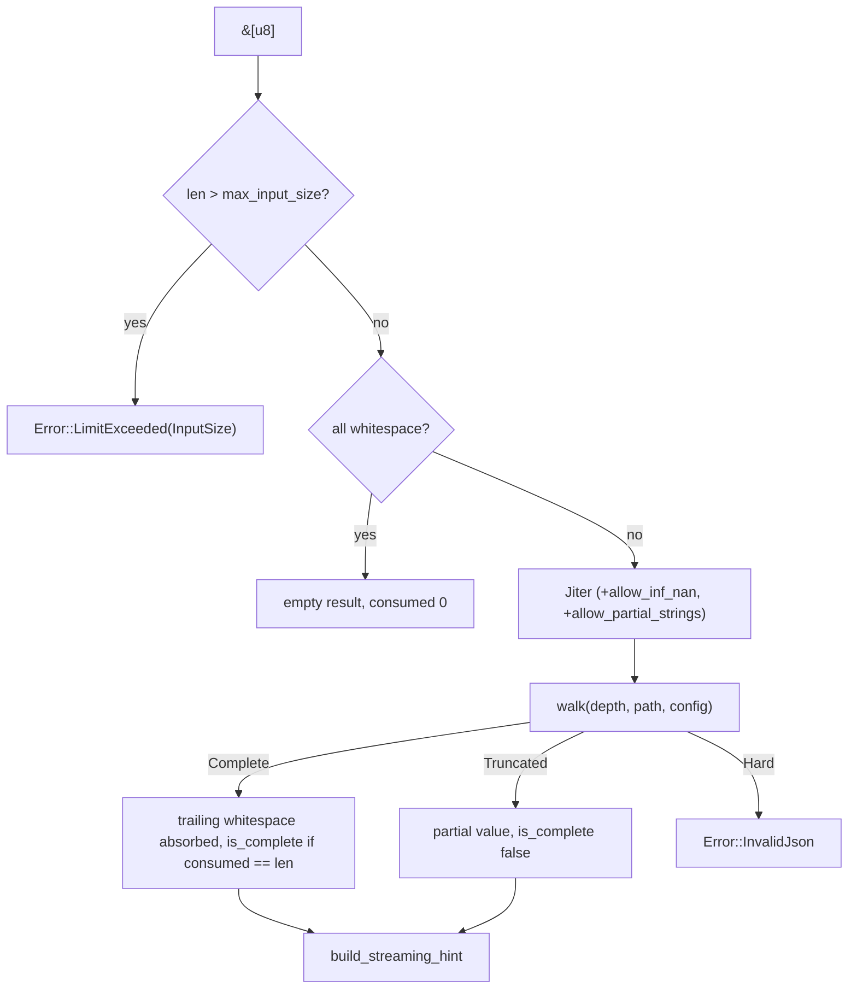

---
aliases:
  - Partial JSON Parser Plan (as built)
tags:
  - sdd
  - plan
  - parser
  - partial-parse
created: 2026-11-15
status: partial
related:
  - "[[039-partial-json-jiter-parser/spec]]"
verified: 2026-11-18
---

# Plan 039: Partial JSON Parser (as built)

Spec: [[039-partial-json-jiter-parser/spec|039]]. Index: [[MOC-specs]].

## Architecture

`JiterPartialParser::parse_partial` builds a `jiter::Jiter` over the input, wraps it in a private `Tokens` (jiter plus input length, so cursors are clamped), and calls a recursive `walk` that returns a `WalkOutcome`:

- `Complete { value, cursor, diagnostics }`
- `Truncated { partial, cursor, diagnostics }` (tolerated EOF-class errors)
- `Hard(JiterError)` (mapped to `Error::invalid_json(index, message)`)

Helpers: `walk_string`, `walk_number`, `walk_array`, `walk_object`, `walk_with_peek`, `build_streaming_hint`, `collect_leaves`, `is_partial_tolerated` (re-implements jiter's `pub(crate)` tolerated-error set: EOF while parsing list/object/string/value, expected list/object comma or end).

## Design decisions

- Per-token jiter API only; the whole-value API hard-codes non-partial mode (documented in module docs).
- `value` is owned `JsonData` so the caller can drop the input buffer.
- Sealed trait lets the project add methods without breaking downstream.
- Depth check is applied in the walker (`depth >= max_depth`) on top of jiter's own recursion limit.
- `JsonData` is used as output type, which is why `jiter` stays in `pjs-core` and `pjs-domain` stays dependency-light.

## Public API surface

`pjson_rs::parser::partial::{PartialJsonParser, JiterPartialParser, JiterConfig, PartialParseResult, StreamingHint, ParseDiagnostic}` and the same names re-exported from `pjson_rs::parser`, behind `partial-parse`.

## Contracts

| Function | Preconditions | Postconditions | Undefined / notes |
|---|---|---|---|
| `parse_partial(input)` | none (any bytes) | `Ok(r)` implies `r.consumed <= input.len()`; `r.is_complete` implies `consumed == input.len()` | `Err(LimitExceeded{InputSize})` above `max_input_size`; `Err(InvalidJson)` for hard syntax errors and depth overflow |
| `parse_partial` on prefix `P` of a valid document `D` | `P` is a prefix of `D` | no error except truncated numbers `1.`/`1e` | the unparsed tail is `&input[consumed..]` |
| `JiterConfig::default()` | none | 100 MiB, depth 64, hints on, partial strings on, inf/nan off | |
| `streaming_hint` | `emit_streaming_hint` and container root | every leaf path in exactly one of the two vectors | tentative choice is hash-order dependent when objects have several keys |

## Testing strategy

- Unit tests in `partial.rs` (boundaries a-e, empty/whitespace, big ints, duplicate keys, hints, exhaustive prefixes, structural alphabet).
- Doc tests on `PartialParseResult::value` (runs) and `no_run` examples.
- Fuzz: `fuzz/fuzz_targets/parser_partial.rs` (the `fuzz` crate enables `partial-parse`).
- CI: the nextest archive in the build job uses `default` features and does not enable `partial-parse`; the coverage job uses `--all-features` and does.

## Security notes

- Bounded by `max_input_size` and `max_depth`; `consumed` clamping removes a past out-of-range slice hazard when partial strings step over a missing closing quote.
- jiter's `num-bigint` feature means huge integer literals allocate; their cost is bounded by `max_input_size`.
