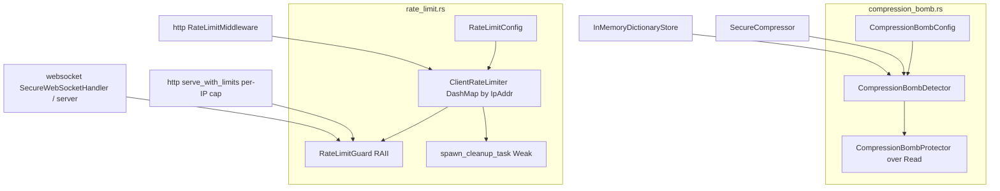

---
aliases:
  - Compression Bomb and Rate Limiting Plan
tags:
  - sdd
  - plan
created: 2026-11-15
status: implemented
related:
  - "[[050-compression-bomb-and-rate-limiting/spec]]"
verified: 2026-11-18
---

# Plan 050: Compression-Bomb Protection and Rate Limiting (as built)

[[050-compression-bomb-and-rate-limiting/spec|Spec]] | [[MOC-specs]]

## Architecture

## Design decisions

- Reject-new at capacity so forged IPs cannot evict established clients' state.
- Guard-based connection accounting (RAII) rather than explicit close calls.
- Cleanup task holds a `Weak<ClientRateLimiter>` and is idempotent per limiter.
- Bomb guard checks at intervals for speed; a final `validate_result` closes the gap.

## Public API surface

Bomb: `CompressionBombConfig::{default, high_security, low_memory, high_throughput}`, `CompressionBombDetector::{new, validate_pre_decompression, protect_reader, protect_nested_reader, validate_result}`, `CompressionBombProtector::{new, with_depth, stats, into_inner}`. Limiter: `ClientRateLimiter::{new, config, check_request, check_connection, close_connection, check_message, remaining_for, reset_after, stats, cleanup_expired, spawn_cleanup_task}`, `RateLimitGuard::{new, check_message}`, constants `MAX_TRACKED_CLIENTS`, `DEFAULT_CLEANUP_INTERVAL`.

## Contracts

| Function | Precondition | Postcondition | Notes |
|---|---|---|---|
| `protect_reader(r, n)` | `n` = compressed length | reads fail with `InvalidData` once limits exceeded at a check point | ratio check needs `n > 0` |
| `validate_result` | | `Ok` iff size <= max and ratio <= max | |
| `check_request(ip)` | | `Ok` records one request; `Err` records nothing | capacity check precedes |
| `RateLimitGuard::new` | | holds one connection slot until drop | |
| `spawn_cleanup_task` | `self` in `Arc` | at most one task; no panic without runtime | |

## Testing strategy

Unit tests in both modules (36 and 33), integration tests listed in the spec, fuzz target `secure_decompress` exercises the protector indirectly. No bench.

## Security notes

Primary DoS controls of the crate. Residual gaps are listed in the spec Open Questions (unwired config sections, unvalidated deserialised configs).
