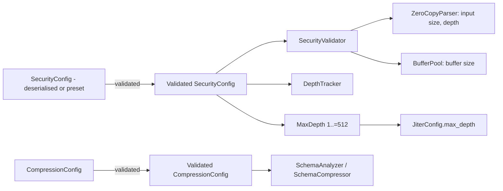

---
aliases:
  - Security Limits and Validated Config Plan
tags:
  - sdd
  - plan
created: 2026-11-15
status: implemented
related:
  - "[[051-security-limits-and-validated-config/spec]]"
verified: 2026-11-15
---

# Plan 051: Security Limits and Validated Config (as built)

[[051-security-limits-and-validated-config/spec|Spec]] | [[MOC-specs]]

## Architecture

`Validate` is sealed; `PjsConfig::validate` chains `streaming`, `parser`, `simd`, `security`, `compression` fail-fast (details in spec 018).

## Design decisions

- Parse-don't-validate: consumers take the proof type, not a raw config plus a runtime check.
- Hard ceiling `MAX_SAFE_JSON_DEPTH = 512` because `sonic-rs` has no recursion limit; the ceiling is a misconfiguration guard, not a stack-size guarantee.
- Separate `MaxDepth` newtype for recursive consumers that need only the depth.

## Public API surface

See spec Scope callout; constructors: `SecurityConfig::{default, high_throughput, low_memory, development, validate}`, `Validate::validated`, `Validated::into_inner`, `MaxDepth::{new, get}`, `SecurityValidator::{new, default, validate_*}`, `DepthTracker::{from_config, with_max_depth, enter, exit, current_depth}`.

## Contracts

| Function | Precondition | Postcondition | Notes |
|---|---|---|---|
| `SecurityConfig::validate` | none | `Ok` iff depth in 1..=512, session id bounds ordered, ten size fields > 0 | other fields unchecked (#614) |
| `Validate::validated` | none | `Validated` holds a config that passed `validate` | sealed |
| `SecurityValidator::validate_json_depth_bytes` | none | `Err` iff structural depth exceeds `max_depth` | O(n) bytes, no allocation |
| `DepthTracker::enter` | | depth +1 or `Err` without change | |
| `MaxDepth::new` | | value in 1..=512 | |

## Testing strategy

Unit: `security.rs`, `config/security.rs`, `config.rs`. Integration: `tests/security_comprehensive.rs`, `tests/security_bounded_iteration_integration.rs`. Doc-tests on `MaxDepth`, `Validate::validated`, `SecurityValidator::new`, `CompressionConfig::validate`. Fuzz: `fuzz/fuzz_targets/parser_zero_copy.rs` reaches the depth check through `ZeroCopyParser`.

## Security notes

Residual risk: limits that exist only in the config (see spec Open Questions 1) give a false sense of bounds; the effective JSON bound today is `max_input_size` plus depth.
