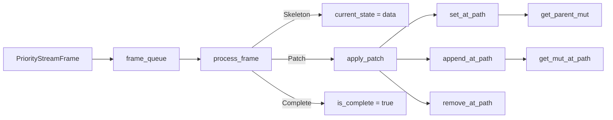

---
aliases:
  - JSON Reconstruction Plan
tags:
  - sdd
  - plan
created: 2026-11-15
status: implemented
related:
  - "[[046-json-reconstruction/spec]]"
verified: 2026-11-15
---

# Plan 046: JSON Reconstruction (as built)

[[046-json-reconstruction/spec|Spec]] | [[MOC-specs]]

## Architecture

Navigation walks `PathSegment::Key` through objects and `PathSegment::Index` through arrays with `get_mut`; no recursion, so path depth costs O(depth) iterations, not stack.

## Public API surface

`JsonReconstructor::{new, add_frame, process_next_frame, process_all_frames, current_state, is_complete, stats, reset, progress, duration}`, `ReconstructionStats::{frames_per_second, patches_per_second}`, `reconstruction::ProcessResult`. Crate root re-exports `JsonReconstructor`.

## Contracts

| Function | Precondition | Postcondition | Notes |
|---|---|---|---|
| `process_all_frames` | none | queue empty on `Ok`; one result per frame | on `Err` earlier frames applied, failing frame consumed |
| `set_at_path` (private) | parent exists | value stored or `Err` | root path replaces document |
| `append_at_path` (private) | target is array | elements appended in order | |
| `progress` | none | in `[0.0, 1.0]`, `1.0` only when complete | estimate, not a measure of bytes |

## Testing strategy

20 unit tests in `crates/pjs-core/src/stream/reconstruction.rs` (creation, skeleton, patches, append, completion, progress, reset, deep nesting 3 and 5, out-of-order patches, remove, replace, root set, error cases, duration). Round trips with `PriorityStreamer` in `stream/priority.rs`. No fuzz target, no benchmark.

## Security notes

Unbounded memory growth from adversarial frames (large `Append`, deep `Set` values). Bounds must be applied by the transport ([[051-security-limits-and-validated-config/spec|spec 051]]).
