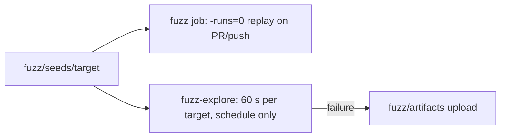

---
aliases:
  - fuzz targets plan
tags:
  - sdd
  - plan
  - fuzzing
created: 2026-11-15
status: implemented
related:
  - "[[076-fuzz-targets/spec]]"
verified: 2026-11-15
---

# Plan 076: as-built

| Target | Entry point | Oracle | Seeds |
|--------|-------------|--------|-------|
| `parser_zero_copy` | `ZeroCopyParser::parse_lazy` | no panic | nested, object, string |
| `parser_partial` | `JiterPartialParser::parse_partial` | `consumed <= len` | complete, open_string_value, truncated_object |
| `secure_decompress` | `SecureCompressor::{decompress_protected, decompress_nested}` | no panic, bounded work | none, deflate, gzip, brotli |
| `streaming_decompressor` | `StreamingDecompressor::decompress_frame` | no panic | none, delta, run_length |
| `ws_message_decode` | `WsMessage` serde round-trip | value equality after re-encode | error, float_payload, ping, stream_frame, stream_init |

## Contracts

| Command | Behaviour |
|---------|-----------|
| `cargo fuzz build --target x86_64-unknown-linux-gnu` (in `fuzz/`) | builds all five bins |
| `cargo fuzz run <target> fuzz/seeds/<target> -- -runs=0` | replays seeds, exits non-zero on crash |
| `cargo fuzz run <target> -- -max_total_time=60 <seeds>` | exploration, writes `fuzz/artifacts` on crash |

## Testing strategy

The fuzz targets are the tests; the crate has `test = false` for each bin. Formatting and clippy run on the fuzz manifest in CI.

## Security notes

Targets exercise the DoS-protection paths named in `CLAUDE.md` (bounded iteration over untrusted input, secure decompression). Found crashes follow the private advisory process in `SECURITY.md`.
