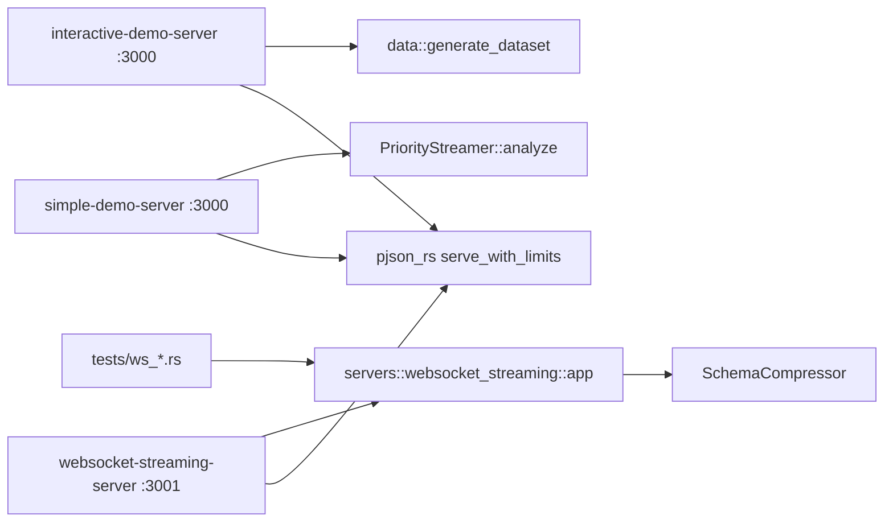

---
aliases:
  - demo servers plan
tags:
  - sdd
  - plan
  - demo
created: 2026-11-15
status: implemented
related:
  - "[[077-demo-servers/spec]]"
verified: 2026-11-15
---

# Plan 077: as-built

## Design decisions

- `lib.rs` exposes only `servers::websocket_streaming` (plus `data`, `utils`) so integration tests build the same `Router` as the binary (`servers/mod.rs` doc).
- Single-owner sessions with an atomic bind guard against TOCTOU double-attach.
- Pause/resume uses a `watch` channel carrying a struct, not an enum (latest-wins semantics).
- Connection lifetime deadline disabled only for the WebSocket server.

## Contracts

| Interface | Guarantee |
|-----------|-----------|
| `POST /stream` | creates an unbound session and returns its WebSocket URL |
| `GET /ws/{id}` | at most one live connection per session |
| text frame `{"command":"pause"}` | no further frames or completion until `resume` |
| `generate_dataset(type, size)` | `serde_json::Value`; item counts per `DatasetSize::item_count` |

## Testing strategy

`tests/ws_upgrade.rs` (valid upgrade streams; 404; 400; concurrent 409) and `tests/ws_pause_resume.rs` (pause blocks completion; rapid pause/resume; resume no-op; unknown field rejected; malformed command does not disrupt). No `#[test]` exists under `crates/pjs-demo/src`.

## Security notes

Loopback bind, no authentication; demo only. `serve_with_limits` provides header-read timeout, connection cap and optional lifetime cap (#523).
