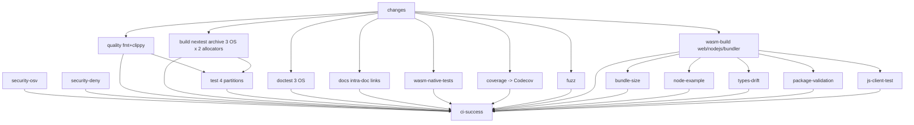

---
aliases:
  - CI pipeline plan
tags:
  - sdd
  - plan
  - ci
created: 2026-11-15
status: implemented
related:
  - "[[078-ci-pipeline/spec]]"
verified: 2026-11-15
---

# Plan 078: as-built

## Design decisions

- Nextest archive built once per OS/allocator, executed in 4 partitions to cut wall time.
- `pjs-wasm` is excluded from archive and doctests (wasm32-only tests, Windows argv limit #344) and run natively on Ubuntu in its own job.
- sccache + `Swatinem/rust-cache` (shared keys per job family) keep builds fast; `save-if: false` on read-only consumers.
- Path filters avoid running Rust jobs for JS-only changes and vice versa; the aggregator treats skipped as success.
- Security scans run on PR, merge queue and schedule, not on every push.

## Contracts

| Gate | Passes when |
|------|-------------|
| `quality` | rustfmt clean, clippy clean with `-D warnings` on all targets and features |
| `test` | all `--lib --bins` tests pass on 3 OS x 2 allocators |
| `ci-success` | no required job is failed or cancelled |
| `security-deny` | no denied advisory, banned crate, unlicensed or yanked dependency |

## Testing strategy

CI is itself the verification layer; local equivalents are the commands in `CLAUDE.md` and `.claude/rules/branching.md`.

## Security notes

Least privilege is incomplete (#588). `pull_request_target` workflows run only trusted base-branch code. Dependabot auto-merge limited to patch/minor after all checks pass.
