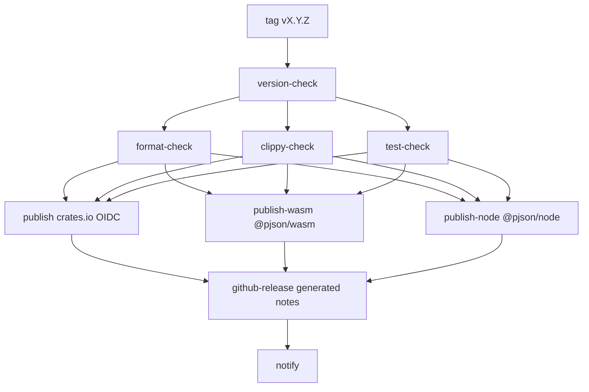

---
aliases:
  - release pipeline plan
tags:
  - sdd
  - plan
  - release
created: 2026-11-15
status: implemented
related:
  - "[[079-release-pipeline/spec]]"
verified: 2026-11-15
---

# Plan 079: as-built

## Design decisions

- OIDC Trusted Publishing for crates.io and npm; no secrets other than `GITHUB_TOKEN`.
- Verification jobs run in parallel after the version gate; publishes run in parallel after verification.
- npm packages are renamed at publish time (`jq` for wasm, `node -e` for the client), keeping in-repo names stable.
- Idempotence through `npm view` checks.

## Contracts

| Step | Precondition | Postcondition |
|------|--------------|---------------|
| `version-check` | tag `vX.Y.Z` | `X.Y.Z` equals workspace version, else job fails |
| `publish` | gates green | crates published in dependency order |
| `publish-wasm` | wasm-pack builds | `@pjson/wasm@X.Y.Z` with provenance, unless present |
| `publish-node` | rollup build passes | `@pjson/node@X.Y.Z` whose `pjs-wasm` optional dep points to `@pjson/wasm@^X.Y.Z` |

## Testing strategy

No dry-run job exists; PR CI covers build and test, `wasm-package-validation` covers package shape ([[072-wasm-packaging-targets/spec]]). `[NEEDS CLARIFICATION: any manual dry-run procedure]`

## Security notes

Provenance + OIDC; environments `crates-io` and `npm` gate publish jobs; `--ignore-scripts` on the npm publish step; open least-privilege gaps #588, #589, #617.
