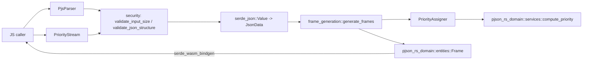

---
aliases:
  - WASM bindings plan
tags:
  - sdd
  - plan
  - wasm
created: 2026-11-15
status: implemented
related:
  - "[[070-wasm-bindings-api/spec]]"
verified: 2026-11-15
---

# Plan 070: pjs-wasm as-built design

## Architecture

`pjs-wasm` is a `cdylib` + `rlib` (`Cargo.toml` `[lib] crate-type`). It depends on `pjson-rs-domain` (features `std`, `wasm`), `serde_json`, `serde-wasm-bindgen`, `tsify`, `js-sys`, `wasm-bindgen`, and optionally `console_error_panic_hook`. It does not depend on `pjson-rs` (core), keeping `sonic-rs`, tokio and axum out of the WASM binary.

Module layout (`lib.rs`): public re-exports `PjsParser`, `PriorityConfigBuilder`, `PriorityConstants`, `SecurityConfig`, `FrameData`, `PriorityStream`, `StreamStats`; `pub mod priority_assignment` and `pub mod security` are public for native tests; the rest are private.

## Design decisions

- `serde_json`, not `sonic-rs`, for parsing: sonic-rs is not WASM-compatible (comment in `parser.rs`; CHANGELOG #486/#488).
- One algorithm in `frame_generation.rs` (CHANGELOG #433 removed the duplicated copies in parser and stream).
- Priority logic lives in the domain crate (#242), so the WASM crate only maps config.
- Builders take `self` by value and return `Self` for JS chaining; shared config objects (`SecurityConfig`) are passed by reference and cloned (#404; see [[033-wasm-security-config-shared-reuse/spec]]).
- Frames are delivered synchronously by `PriorityStream.start`; there is no incremental input API.

## Public API surface

JS names: `PjsParser` {`new`, `withConfig`, `withSecurityConfig`, `parse`, `generateFrames`, static `version`}; `PriorityStream` {`new`, `withConfig`, `setSecurityConfig`, `setMinPriority`, `onFrame`, `onComplete`, `onError`, `start`}; `PriorityConfigBuilder` (6 chainable setters); `PriorityConstants` (5 getters); `SecurityConfig` ([[071-wasm-security-limits/spec]]); free `version()`.

## Contracts

| Function | Preconditions | Postconditions | Undefined / notes |
|----------|---------------|----------------|-------------------|
| `PjsParser.parse(json)` | `json` is UTF-8 (JS string) | returns `JsonData` as JS value or throws prefixed string | numbers beyond i64/f64 follow `From<serde_json::Value>` fallback in domain |
| `PjsParser.generateFrames(json, min)` | `min != 0` | frames: skeleton first, complete last, patches strictly descending priority, sequences 0..n | all patches below `min` dropped; if none remain, only skeleton + complete |
| `PriorityStream.start(json)` | callbacks optional | `onFrame` x N then `onComplete`; or `onError` + throw | callbacks run synchronously; exceptions thrown by callbacks are ignored |
| `PriorityStream.setMinPriority(p)` | `p != 0` | stores `p` | `p > 100` accepted |
| `build_skeleton(data, 0, max_depth)` | - | same shape, neutral leaves, `Null` at depth cap | internal |
| `PriorityAssigner.extract_prioritized_fields_with_limit` | - | every object key visited up to depth; array elements traversed but not emitted themselves | depth counted per container |

## Testing strategy

- Native (`cargo nextest run -p pjs-wasm --tests`, CI `wasm-native-tests`): `tests/priority_parity.rs` (3 tests), `tests/streaming_comprehensive.rs` (52 tests; SecurityConfig and `validate_input_size`), native unit tests in `parser.rs` (15), `streaming.rs` (8), `security.rs` (16), `priority_assignment.rs`, `priority_config.rs`, `priority_constants.rs`, `utils.rs`.
- `#[wasm_bindgen_test]` modules in `parser.rs` and `streaming.rs` run only with `wasm-pack test` on `wasm32`; CI does not run `wasm-pack test` (the root CLAUDE.md/branching rules list it as a pre-PR step). `[NEEDS CLARIFICATION: whether wasm-pack test is run anywhere automated]`
- Excluded from the nextest archive and doctests of the main `build`/`doctest` jobs (`--exclude pjs-wasm`).

## Security notes

See [[071-wasm-security-limits/spec]]. Frame generation clones every field value into patches, so memory is bounded by input size times the patch duplication factor (each value appears once in patches; nested objects also appear inside their parent's value).
