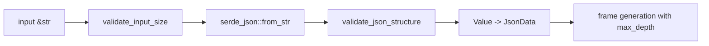

---
aliases:
  - WASM security plan
tags:
  - sdd
  - plan
  - wasm
  - security
created: 2026-11-15
status: implemented
related:
  - "[[071-wasm-security-limits/spec]]"
verified: 2026-11-15
---

# Plan 071: as-built

Validation order in `PjsParser::parse`, `PjsParser::generate_frames`, `PriorityStream::start`:

## Contracts

| Function | Precondition | Postcondition |
|----------|--------------|---------------|
| `validate_input_size(&str, &SecurityConfig)` | - | `Ok` iff `len <= max_json_size` |
| `validate_array_size(count, cfg)` / `validate_object_size` | - | `Err` iff `count > max` |
| `validate_json_structure(&Value, cfg)` | parsed value | `Ok` iff all nested arrays and objects within limits; recursion depth bounded by serde_json parse cap |
| `validate_depth(depth, cfg)` | - | `Err` iff `depth > max_depth`; not wired |

## Testing

`crates/pjs-wasm/tests/streaming_comprehensive.rs` (SecurityConfig + `validate_input_size`), unit tests in `security.rs` (including structure-validation cases), `parser.rs` unit tests (`test_create_skeleton_with_depth_limit`).
