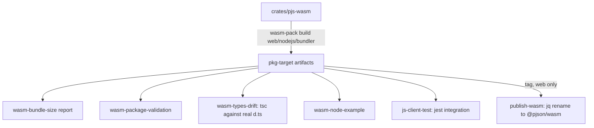

---
aliases:
  - WASM packaging plan
tags:
  - sdd
  - plan
  - wasm
created: 2026-11-15
status: implemented
related:
  - "[[072-wasm-packaging-targets/spec]]"
verified: 2026-11-15
---

# Plan 072: as-built

## Design decisions

- Three targets built in CI because consumers differ; only `web` is published and consumed by tests (`crates/pjs-js-client` loads it through a Node CJS shim, see [[074-js-client-wasm-integration/spec]]).
- Native tests run outside wasm-pack (`wasm-native-tests`) because the nextest archive for the workspace excludes `pjs-wasm` (web-sys check-cfg argv limit on Windows, #344; `ci.yml` comments).
- `wasm-build` deliberately does not `need` `quality`, so JS-only PRs still produce the artifact (#383).

## Contracts

| Interface | Guarantee |
|-----------|-----------|
| `wasm-pack build --target web` | emits `pjs_wasm.js` (ESM, `"type": "module"`), `pjs_wasm_bg.wasm`, `pjs_wasm.d.ts` |
| `init(module_or_path)` default export | must be awaited before using classes in `web` target (Node loader passes `{ module_or_path: Buffer }`) |
| `package.json` fields | `name`, `version`, `files`, `main`, `types` required by CI |

## Testing strategy

CI jobs listed above; local equivalents in `crates/pjs-wasm/README.md` and `crates/pjs-js-client/examples/browser-wasm/package.json` (`build:wasm`).

## Security notes

npm publish uses Trusted Publishing (OIDC, `--provenance`), Node 24; see [[079-release-pipeline/spec]].
