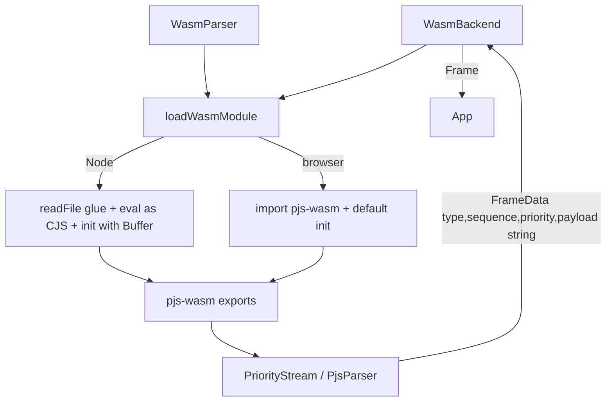

---
aliases:
  - JS client WASM plan
tags:
  - sdd
  - plan
  - typescript
  - wasm
created: 2026-11-15
status: implemented
related:
  - "[[074-js-client-wasm-integration/spec]]"
verified: 2026-11-15
---

# Plan 074: as-built

## Design decisions

- Node loader reads and evaluates the wasm-pack `web`-target glue itself because Jest routes dynamic `import()` through its CJS loader (CHANGELOG #383).
- `pjs-wasm` is an `optionalDependencies` file link (`file:../pjs-wasm/pkg`); consumers without it get native `JSON.parse` through `WasmParser` and an `InitializationError` from `WasmBackend`.
- Frame conversion is duplicated in `wasm-backend.ts` and `wasm-parser.ts` (`convertWasmFrame` vs `convertWasmFrameToFrame`; `metadata.source` differs: `wasm` vs `wasm-parser`).

## Contracts

| Function | Precondition | Postcondition |
|----------|--------------|---------------|
| `loadWasmModule()` | `pjs-wasm` resolvable | initialised module, one instance per process in Node |
| `WasmBackend.startStream` | connected, `jsonData` non-empty, no active stream | frames emitted synchronously during the call; Complete frame emitted last |
| `WasmParser.parse` | initialised or not | WASM parse if available, else `JSON.parse`; always `PJSError` on failure |
| `WasmParser.dispose` | - | parser freed, `wasmAvailable=false` |

## Testing strategy

`tests/integration/wasm-backend.test.ts` (real package, with an `installMockPriorityStream()` helper replacing `PriorityStream` on the cached module), `tests/integration/wasm-parser.test.ts`, `tests/parser/wasm-parser.test.ts` (mocked), guard in `tests/integration/wasm-pkg.ts`. CI: `js-client-test`, `wasm-types-drift`, `wasm-node-example` ([[078-ci-pipeline/spec]]).

## Security notes

The Node loader executes code from the resolved package (`new Function`); trust boundary is the installed npm package (published with provenance, see [[079-release-pipeline/spec]]).
