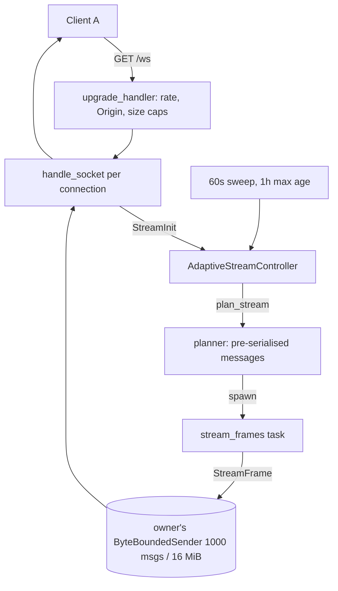

---
aliases:
  - WebSocket server transport plan
tags:
  - sdd
  - plan
  - websocket
created: 2026-11-15
status: implemented
related:
  - "[[066-websocket-server-transport/spec|066 spec]]"
  - "[[constitution]]"
code:
  - crates/pjs-core/src/infrastructure/websocket/server.rs
  - crates/pjs-core/src/infrastructure/websocket/mod.rs
  - crates/pjs-core/src/infrastructure/websocket/planner.rs
  - crates/pjs-core/src/infrastructure/websocket/controller.rs
verified: 2026-11-15
---

# Plan (as-built): WebSocket server transport

## Architecture

## Design decisions

- One select loop per connection owning the socket sink, so every write goes through `send_with_write_timeout`.
- Frames go straight into the owning connection's bounded channel; the controller keys sessions by connection, so a session id is private to its connection and a slow reader stalls only its own sessions (#569, #570, #571, #572).
- `send_frame` is fire-and-forget with `try_send` to rule out deadlock on the connection's own loop.
- Fixed-text replies and length-only logging prevent echo and log amplification.
- Origin default is deny-all for browsers while native clients (no `Origin`) keep working.
- The plan is built once at session creation and kept as pre-serialised messages; the per-connection plan budget (`live_plan_bytes`, released frame by frame and on every removal path) bounds memory of live plans, and pacing and deadlines bound how long a session can occupy it.
- `CreateSessionError` is `#[non_exhaustive]` so further rejection reasons are not breaking.
- WebSocket session model is deliberately separate from the `StreamSession` aggregate (issue #239).

## Public API surface

`AxumWebSocketTransport` (`new`, `with_rate_limit_config`, `with_allowed_origins`, `with_shutdown`, `with_max_sessions_per_connection`, `upgrade_handler`, `handle_socket`, `controller`, `active_connection_count`), `create_websocket_router`, `AdaptiveStreamController`, `ConnectionId`, `CreateSessionError` (`AlreadyExists`, `TooManySessions`, `InvalidOptions`, `PlanRejected`), `ClientMetrics`, `StreamOptions`, `WsMessage`, `SecureWebSocketHandler`, `byte_bounded_channel` (`infrastructure::bounded_channel`).

## Contracts

| Function | Precondition | Postcondition | Undefined / notes |
|---|---|---|---|
| `AxumWebSocketTransport::new` / `with_rate_limit_config` | inside a Tokio runtime | sweep task spawned; Origin policy `DenyAll` | Does not panic outside a runtime (#602) |
| `upgrade_handler` | `ConnectInfo<SocketAddr>` present | 429, 403, or upgrade with size caps | Missing `ConnectInfo` yields 500 |
| `create_session(id, owner, data, opts)` | none | inserts iff id free, session cap not reached, options valid and the plan fits the connection budget | Never overwrites; `AlreadyExists`, `TooManySessions`, `InvalidOptions` or `PlanRejected` otherwise; no session on error |
| `plan_stream(id, data, opts)` | validated options | frames ordered by priority desc, one priority each, each within the frame limit (unless one entry cannot split) | `PlanError`: `UnitExceedsBudget`, `TooManyFrames`, `PlanBytesExceeded`, `PathTooDeep`, `ConnectionBudgetExhausted` (budget check at registration) |
| `handle_frame_ack(owner, ...)` | session exists and owned by `owner` | appends ack, updates EMA | Otherwise `UnknownSession`, no state change |
| `remove_sessions_owned_by(owner)` | none | removes and aborts all of owner's sessions, returns count | O(owner's sessions) |
| `send_frame(conn, msg)` | none | `Ok(())` always; frame queued or dropped with warn | No delivery acknowledgement |
| `cleanup_expired_sessions(max_age)` | none | sessions older than `max_age` removed and aborted, plan reservation released | Age counts from creation, not activity; streams normally end earlier via the stall timeout (30 s per enqueue) or deadline (120 s + plan_bytes / 64 KiB/s) |

## Testing strategy

Wire-level tests in `tests/websocket_wire_level.rs` (require `http-server` + `websocket-client`; Cargo test-target `required-features`), `tests/websocket_security.rs` (`websocket-server`), `tests/websocket_server_comprehensive.rs`, `tests/websocket_server_acceptance.rs` (planner, patch framing, budgets, 408/413/429 replies), planner unit tests in `planner.rs`, doctests on `AdaptiveStreamController`, fuzz target `fuzz/fuzz_targets/ws_message_decode.rs`. See [[012-websocket-integration-test-infra/spec|012]].

## Security notes

CSWSH (issue #417), unbounded inbound frames (#334), write stalls (#325), byte-bounded queues (#349), cross-connection leak (#569), per-IP accounting (#250) are closed; open items are listed in the spec.
