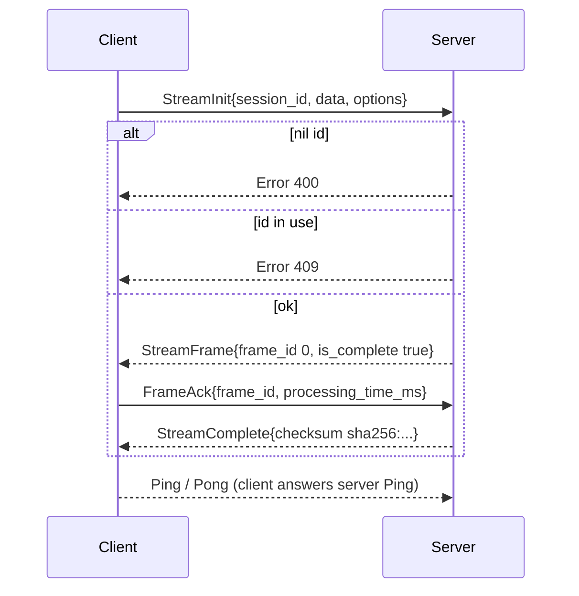

---
aliases:
  - WebSocket wire protocol plan
tags:
  - sdd
  - plan
  - websocket
  - protocol
created: 2026-11-15
status: implemented
related:
  - "[[067-websocket-wire-protocol/spec|067 spec]]"
  - "[[constitution]]"
code:
  - crates/pjs-core/src/infrastructure/websocket/mod.rs
verified: 2026-11-15
---

# Plan (as-built): WebSocket wire protocol

## Architecture

## Design decisions

- Adjacent tagging (`tag = "type"`, `content = "data"`) keeps payloads under one key so new variants never collide with field names.
- `SessionId` travels through `serde_support::session_id` (canonical string out, lenient UUID forms in) so the domain newtype is preserved in Rust types.
- Server-side `ConnectionId` is never serialised, so ownership cannot be forged by a peer.
- Checksum includes frame count to detect truncation, not just content.
- Fixed error strings avoid reflecting attacker input.

## Public API surface

`WsMessage`, `StreamOptions` re-exported at `infrastructure::{WsMessage, StreamOptions}` (feature `http-server`).

## Contracts

| Item | Precondition | Postcondition | Undefined / notes |
|---|---|---|---|
| `serde_json::from_str::<WsMessage>` | text frame | variant or error | Untrusted input; fuzzed |
| `calculate_stream_checksum(frames)` | payload byte vectors | `sha256:` + hex | Private; not exposed for verification |
| `StreamInit` handling | decoded | one frame then complete, or 400/409 | `options` unused |

## Testing strategy

`tests/websocket_wire_level.rs` asserts the id echo, error codes and routing over real sockets; `tests/serde_wire_format.rs` for serde shapes; fuzz target `ws_message_decode`.

## Security notes

Peer-controlled strings are never echoed; inbound size and rate bounded in the transport ([[066-websocket-server-transport/spec|066]]).
