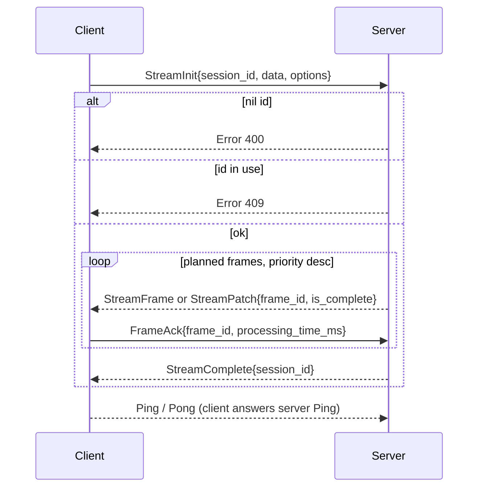

---
aliases:
  - WebSocket wire protocol plan
tags:
  - sdd
  - plan
  - websocket
  - protocol
created: 2026-11-15
status: implemented
related:
  - "[[067-websocket-wire-protocol/spec|067 spec]]"
  - "[[constitution]]"
code:
  - crates/pjs-core/src/infrastructure/websocket/protocol.rs
  - crates/pjs-core/src/infrastructure/websocket/planner.rs
verified: 2026-11-15
---

# Plan (as-built): WebSocket wire protocol

## Architecture

## Design decisions

- Adjacent tagging (`tag = "type"`, `content = "data"`) keeps payloads under one key so new variants never collide with field names.
- `SessionId` travels through `serde_support::session_id` (canonical string out, lenient UUID forms in) so the domain newtype is preserved in Rust types.
- Server-side `ConnectionId` is never serialised, so ownership cannot be forged by a peer.
- `framing` is omitted on the wire when merge, so legacy `StreamInit` bytes are unchanged and old peers keep working; patch framing is opt-in per session.
- Patch paths are arrays of typed segments (string key, integer index) rather than dotted strings, so every key is expressible and index vs key is unambiguous; depth is capped at 128 when a patch is applied (not at decode) to protect receivers from stack-deep state.
- Patch grammar is a closed set of four ops (`set`, `merge`, `append`, `append_str`) decoded strictly; malformed patches are decode errors.
- Fixed error strings avoid reflecting attacker input.

## Public API surface

`WsMessage` (incl. `StreamPatch`), `StreamOptions` (incl. `framing: Framing`), `Framing`, `WirePatch`, `WirePath`, `WireSegment`, `MAX_PATCH_PATH_DEPTH`, re-exported from `infrastructure::websocket`.

## Contracts

| Item | Precondition | Postcondition | Undefined / notes |
|---|---|---|---|
| `serde_json::from_str::<WsMessage>` | text frame | variant or error | Untrusted input; fuzzed |
| `StreamInit` handling | decoded | planned frames then `StreamComplete`, or 400/409/413/429 | Options validated and applied by the planner |
| `WirePatch` decode | 3-array `[op, path, arg]` | typed patch or error | Path length is checked by `apply_patch`, not at decode; fuzzed |

## Testing strategy

`tests/websocket_wire_level.rs` asserts the id echo, error codes and routing over real sockets; `tests/serde_wire_format.rs` for serde shapes; protocol unit tests for patch grammar and `framing` omission/rejection; fuzz target `ws_message_decode`.

## Security notes

Peer-controlled strings are never echoed; inbound size and rate bounded in the transport ([[066-websocket-server-transport/spec|066]]).
