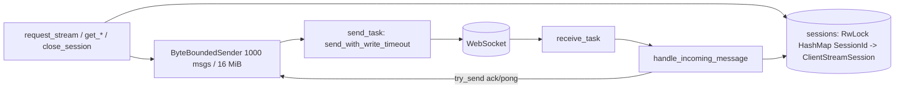

---
aliases:
  - WebSocket client plan
tags:
  - sdd
  - plan
  - websocket
  - client
created: 2026-11-15
status: partial
related:
  - "[[068-websocket-client/spec|068 spec]]"
  - "[[constitution]]"
code:
  - crates/pjs-core/src/infrastructure/websocket/client.rs
verified: 2026-11-18
---

# Plan (as-built): WebSocket client

## Architecture

## Design decisions

- Client chooses the `SessionId`, which the server adopts, so state is keyed before any frame arrives (issue #563).
- Idle TTL, session count limit and per-session byte cap bound memory from a hostile server (issue #565).
- `SessionIdleTtl` newtype with a validating constructor makes a zero TTL unrepresentable.
- `NonZeroUsize` for `max_sessions` makes a zero cap unrepresentable.
- `reserve_session_slot` evicts only incomplete sessions to avoid silently discarding finished data.
- Control messages use `try_send` so the read loop cannot deadlock on a full queue.
- Size accounting is incremental (`entry_size`) to avoid re-serialising the whole session per frame.

## Public API surface

`PjsWebSocketClient` (`new`, `with_config`, `with_write_timeout`, `connect`, `request_stream`, `get_current_data`, `is_stream_complete`, `get_stream_stats`, `close_session`), `WebSocketClientConfig`, `SessionIdleTtl`, `StreamStats`, `ClosedSession`. Crate-level re-exports require `http-server` + `websocket-client`.

## Contracts

| Function | Precondition | Postcondition | Undefined / notes |
|---|---|---|---|
| `request_stream` | none (connect may come later) | session slot reserved; message queued; id returned | Queue accepts before `connect`; blocks if queue full |
| `connect` | called once | returns when send or receive task ends | Second call errors; blocks for the connection lifetime |
| `close_session` | none | session removed; data returned if not expired | Server not notified |
| `apply_frame` (private) | payload | state unchanged on size violation | Object merge replaces keys wholesale |

## Testing strategy

Unit tests in `client.rs` (30) including TTL and eviction via injected `Instant`; wire tests against a real server and a one-shot sender in `tests/websocket_wire_level.rs`. No fuzz target on the client.

## Security notes

Untrusted server input is bounded in message size, frame size, session count, per-session bytes and idle time. The workspace declares `tokio-tungstenite = "0.30"` with default features and no TLS feature, so `wss://` support is [NEEDS CLARIFICATION: not enabled by any listed feature].
