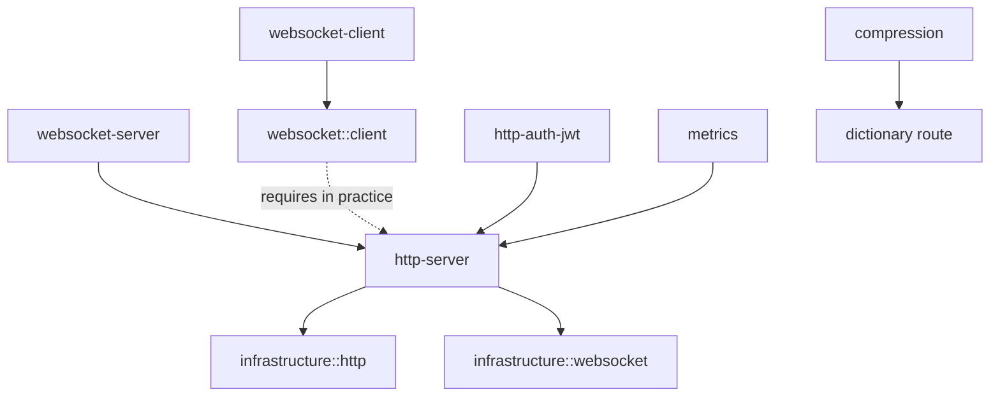

---
aliases:
  - Transport features and limits plan
tags:
  - sdd
  - plan
  - features
created: 2026-11-15
status: implemented
related:
  - "[[069-transport-features-and-limits/spec|069 spec]]"
  - "[[constitution]]"
code:
  - crates/pjs-core/Cargo.toml
  - crates/pjs-core/src/infrastructure/mod.rs
verified: 2026-11-15
---

# Plan (as-built): feature gating and limits

## Architecture

## Design decisions

- All transport code hangs off `http-server`; `websocket-server` is an alias feature, so `websocket::server` is compiled whenever HTTP is.
- Limits are `const`s next to the code enforcing them, with rationale in rustdoc, rather than a central config; shared bounds (`MAX_PAGINATION_*`, `MAX_FRAMES_PER_REQUEST`, `MAX_SESSION_TIMEOUT_SECONDS`) live in `domain::config::limits` so domain and adapters agree.
- Presets (`high_traffic`, `low_resource`) exist only for the WebSocket/limiter `RateLimitConfig`.

## Public API surface

See FR-005 in the spec.

## Contracts

| Item | Precondition | Postcondition | Undefined / notes |
|---|---|---|---|
| Feature `websocket-client` alone | none | build fails | #598 |
| Feature `metrics` | nightly | `/metrics` route and counter | `once_cell_try` |
| Cargo test-target `required-features` | listed features | test target compiled only then | `websocket_wire_level` needs `http-server` + `websocket-client` |

## Testing strategy

CI feature matrix is defined in `.github/workflows` [NEEDS CLARIFICATION: not reviewed for this spec]; per-feature coverage is described in the transport specs.

## Security notes

Defaults are conservative and overridable; deployment-specific caveats (reverse proxy, WebSocket duration ceiling) are in [[062-http-serve-connection-limits/spec|062]].
